这一页是预览的语法清单，按「基础语法、块级容器、站点组件、图表」分类。每一类都先给语法，再列这个容器或组件的全部属性与取值，然后给可以跑的实例；改完渲染器，先打开这里看有没有退化。


# 一、基础语法

## 标题

一级标题用 `#`，最多六级。下面依次是一级到六级：

# 一级标题

## 二级标题

### 三级标题

#### 四级标题

##### 五级标题

###### 六级标题

也可以只给文字，下一行写 `===` 或 `---`，这就是 Setext 写法，只分两级：

Setext 一级标题
==============

Setext 二级标题
--------------

标题里可以放行内样式与链接：`代码`、**粗体**、*斜体* 与 [ETAF](https://etaf.top)。

## 标题锚点

标题带自动生成的锚点，同一份文档里重复的标题会追加序号：

## 重复的标题

## 重复的标题

## 段落与换行

一个段落由空行分隔。段内的换行是软换行，按 CommonMark 的规则折成一个空格，整段跟着阅读栏的宽度重新折行：

这一段的第一行
第二行接着上一行
第三行也属于同一段，三行在页面上连成一段，按栏宽折行

想让这一行强制换行，行尾留两个空格，  
这一行就是被两个空格断开的。

也可以用一个反斜杠达到同样效果：\
这一行跟在反斜杠后面。

很长的段落用来检查折行：中文在这里连续写下去，一行放不下的时候应当在阅读栏的宽度里折行，折行不丢字，也不把标点挤到下一行的行首，更不把整段压成一行。

中文与 English 混排、数字 42 与符号 `$` 之间要留一个空格，读起来才不挤。

## 转义与实体

反斜杠让标记变成普通字符：\*不是强调\*、\`不是代码\`、\# 不是标题、\[ 不是链接、\\ 是反斜杠本身。

命名实体、十进制与十六进制都生效：&copy; &mdash; &amp; &lt;tag&gt; &#65; &#x41;。

行内的 HTML 按原样显示：<kbd>Ctrl+Enter</kbd>、<sub>下标</sub>、<sup>上标</sup>。

## 行内样式

**粗体**、*斜体*、***粗斜体***、~~删除线~~、`行内代码`。

风格可以嵌套：**粗体里有 *斜体* 与 `代码`**，*斜体里有 **粗体***。

词内的下划线不算强调，所以 snake_case_name 与 __init__ 保持原样。

没有配对的标记不解析：这是一个 * 号，这里是两个 ** 号。

行内代码里的标记不解析：`**这些星号不是粗体**`；反引号可以包住空格：` a b `。

行内代码也能用双反引号包住一个反引号：``a ` b``。

## 链接

- 行内链接：[ETAF 仓库](https://github.com/emacs-taf/etaf)。
- 带标题的链接，鼠标停在上面能看到标题：[Ebox 渲染器](https://github.com/emacs-taf/ebox "Ebox 的排版引擎")。
- 引用式链接：[规范][commonmark]、折叠式 [折叠式][]、快捷式 [快捷式]。
- 自动链接：<https://etaf.top> 与裸地址 https://github.com/emacs-taf/etaf-ui 。
- 邮箱地址也能识别：<mail@example.com>。
- 链接里的文字可以带样式：**[粗体链接](https://etaf.top)** 与 [`代码链接`](https://etaf.top)。
- 本页内的锚点链接：[回到标题](#标题)。
- 定义式链接的地址写在这里，页面不显示这一行：

[commonmark]: https://spec.commonmark.org "CommonMark 规范"
[折叠式]: https://github.github.com/gfm/
[快捷式]: https://etaf.top

## 图片

本地图片渲染成卡片，按 `RET` 用系统程序打开：

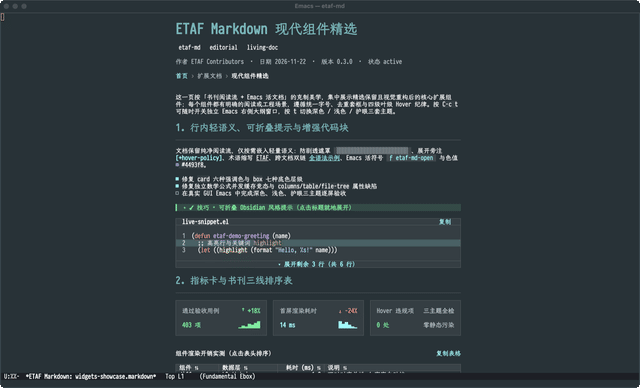

远程图片画出占位卡片，激活后在浏览器里打开：


图片也可以只有替代文字，文件不存在时显示替代文字：


引用式图片：![引用式图片][shot]

[shot]: ../tests/fixtures/preview-media.png "引用式定义"

## 列表

无序列表三种标记都能用：

- 连字符
* 星号
+ 加号

有序列表从任意数字开始，`1.` 与 `1)` 两种分隔符都认：

3. 从三开始
4. 继续
5. 结束

1) 圆括号一
2) 圆括号二

嵌套可以多层，标记与缩进要对齐：

- 第一层
  - 第二层
    - 第三层
      - 第四层
- 回到第一层

有序与无序可以混着嵌套：

1. 第一步
   - 细节一
   - 细节二
2. 第二步

紧凑列表的项目之间没有空行，渲染成连续的条目：

- 紧凑一
- 紧凑二
- 紧凑三

松散列表的项目之间有段落，条目之间就多一行：

- 松散一

- 松散二

- 松散三

任务列表三种状态都有：

- [x] 已完成
- [X] 大写也算完成
- [ ] 未完成

列表项里可以放段落与代码块：

- 第一段文字。

  同一项的第二个段落，缩进与标记对齐。

  ```elisp
  (message "列表里的代码块")
  ```

列表项里可以放引用与表格：

- 引用如下：

  > 列表项里的引用。

- 表格如下：

  | 键 | 值 |
  | --- | --- |
  | a | 1 |

空条目也占一行：

-
- 后面的条目

## 引用

普通引用，文字颜色淡一档，链接与代码保持自己的颜色：

> 普通引用。引用里的文字颜色淡一档，链接与代码保持自己的颜色。

引用里可以有多个段落，用一个只有 `>` 的行分开：

> 第一个段落。
>
> 第二个段落。

引用可以嵌套，第二层再淡一档：

> 外层引用
>
> > 内层引用
> >
> > > 第三层

引用里可以放标题、列表、代码块与表格：

> ## 引用里的标题
>
> - 引用里可以放列表
> - 第二项
>
> ```sh
> echo "引用里的代码块"
> ```
>
> | 键 | 值 |
> | --- | --- |
> | a | 1 |

## 提示块

五种提示块都用 `> [!类型]` 开头：

> [!NOTE]
> 一般性的补充说明。

> [!TIP]
> 更省事的做法。

> [!IMPORTANT]
> 读之前必须知道的事。

> [!WARNING]
> 会出问题的地方。

> [!CAUTION]
> 可能造成损失的操作。

## 代码块

围栏代码块带语言名时，用那个语言自己的 `font-lock` 着色：

```elisp
(defun greet (name)
  "Say hello to NAME."
  (message "hello %s" name)) ; 注释
```

```python
def add(a, b):
    return a + b  # 求和
```

```sh
grep -i "needle" file.txt | wc -l
```

```js
const answer = items.filter((item) => item.done).length
```

不写语言的围栏只画一种颜色：

```
普通代码，没有语言
```

标题写在 `title=` 里，`:line-numbers` 开行号，`:line-numbers=3` 从 3 起，`:no-line-numbers` 关行号。

```elisp title="lisp/etaf-md-env.el" :line-numbers
(defun etaf-md--hairline (env)
  "Return a one-pixel border as the Theme ENV's page lives in defines it."
  (etaf-theme-token
   :ui-panel-border
   (or (etaf-md--palette-value (etaf-md-env-palette env) :border)
       "#3a3f4b")))
```

```elisp :line-numbers=3
(defun etaf-md--muted (env)
  (or (etaf-md--palette-value (etaf-md-env-palette env) :muted)
      "#9198a1"))
```

```elisp :no-line-numbers
(etaf-md-open "笔记")
```

花括号里的行号刷高亮：

```elisp {3,6-7}
(defun etaf-md--muted (env)
  "Return the muted ink of ENV's palette."
  (or (etaf-md--palette-value (etaf-md-env-palette env) :muted)
      "#9198a1"))
```

行尾标记决定这一行怎么画，标记本身不出现：

```elisp
(defun etaf-md--toggle-line (env block line)
  (let ((open (etaf-md-block-state env :open)))        ; [!code --]
    (etaf-md-set-block-state env :open (not open))))   ; [!code ++]
```

```elisp
(defun etaf-md--fold (text width)
  (let ((rows (etaf-md--wrap text width)))  ; [!code warning]
    (mapconcat #'identity rows "\n")))      ; [!code error]
```

```elisp
(defun etaf-md--focus (text)   ; [!code focus]
  (etaf-md--fold text 80))
```

标题行右侧有「复制」，把去掉标记的代码放进 kill ring。

波浪线也能围栏：

~~~ruby
puts "tilde fence"
~~~

四个反引号可以包住三个反引号：

````
```
inner fence
```
````

不认识的围栏语言保持源码，不报错：

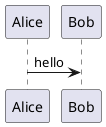

缩进四个空格也写成代码块：

    这是缩进四个空格写成的代码块
    (indented code block)

代码块里的空行原样保留：

```text
第一行

第三行
```

## 表格

左对齐：

| 语法 | 说明 |
| :--- | :--- |
| 定义列表 | 术语加定义 |
| 上下标 | Unicode 字符 |

右对齐：

| 语法 | 说明 |
| ---: | ---: |
| 定义列表 | 术语加定义 |
| 上下标 | Unicode 字符 |

居中对齐：

| 语法 | 说明 |
| :--: | :--: |
| 定义列表 | 术语加定义 |
| 上下标 | Unicode 字符 |

三种对齐在一张表里对比：

| 左 | 中 | 右 |
| :--- | :--: | ---: |
| 短 | 短 | 短 |
| 长一点的文字 | 长一点的文字 | 长一点的文字 |

单元格里可以有 `代码`、**粗体** 与 [链接](https://etaf.top)：

| 内容 | 写法 |
| --- | --- |
| `代码` | 反引号 |
| **粗体** | 星号 |
| [链接](https://etaf.top) | 方括号加圆括号 |

竖线要转义才能放进单元格：`a \| b` 写成 `a \| b`。

| 表达式 | 结果 |
| --- | --- |
| a \| b | 逻辑或 |
| c \| d | 也是逻辑或 |

空单元格与不齐的行也能渲染：

| a | b | c |
| --- | --- | --- |
| 1 |  | 3 |
| 4 | 5 |

中文与 English 混排的单元格会按列宽折行，短词保持完整：

| 语法 | 说明 |
| --- | --- |
| 很长的中文单元格会把这段说明折成几行，短词不拆开 | 右侧列宽跟随内容 |
| `code` keeps together | 中英混排 |

## 分隔线

三条横线、星号或下划线都行，字符之间可以有空格：

---

***

___

- - -

* * *

## 脚注

正文里点一下脚注引用[^spec]，跳到底部的定义；第二个引用[^dup]用来说明重复定义；同一个脚注引用两次[^spec]也只出现一条。

未定义的引用[^missing]保持原样，不会生成条目。

[^spec]: CommonMark 规范定义核心语法，GFM 在其上增加扩展。

[^dup]: 这个标签第一次定义的内容生效。

[^dup]: 第二次定义忽略，避免同号出现两条。

## 定义列表

单个术语一条定义：

编解码器
: 把文本写进帧的工具。

一个术语可以有多条定义：

渲染器
: 第一层输出，负责画格子。

: 第二条定义，说明的另一面。

多个术语可以共用一个定义：

Term A
Term B
: 两个术语共享这一条定义。

用 `~` 当标记也能起一条定义：

**加粗术语**
~ 用 `~` 当标记也能起一条定义，效果与 `:` 相同。

定义里可以放代码块：

缩进
: 说明里放代码：

      (encode "text" coding-system)

定义里可以放列表：

步骤
: 说明里放列表：

  - 第一步：读
  - 第二步：写

## 上下标

水是 H~2~O，能量是 E = mc^2^，面积单位 m^2^，化学式 CO~2~。

上下标只支持 Unicode 里有的字符，`H~2~O` 能排，`x~abc~` 这种没有对应字符的写法保持原样。

字母与多字符混用：x~i~、a^b^、2^10^、10^-3^。

## 缩写

用一行定义把缩写与全称绑起来，正文里整词出现时显示提示：

*[HTML]: HyperText Markup Language
*[CSS]: Cascading Style Sheets

HTML 与 CSS 是网页的两块基石；HTML5 与 CSS3 不是这两个词，所以不加提示。

## 数学

行内公式用单个美元符：$\frac{a}{b}$、$\sqrt{x}$、$a^2 + b^2 = c^2$、$\alpha + \beta$。

价格不会被当成公式：$5、$5.00、$99.9 都还是钱；转义的 \$5 也是钱。

显示公式用两个美元符，单独成块并居中排版：

$$
\sum_{i=1}^{n} i = \frac{n(n+1)}{2}
$$

$$
\int_{0}^{\infty} e^{-x^2} \, dx = \frac{\sqrt{\pi}}{2}
$$

$$
\frac{\partial^2 u}{\partial t^2} = c^2 \nabla^2 u
$$

没装 mermaid-cli 时公式用 Unicode 近似，读得出意思。

## 表情短码

启动成功 :tada:，上线 :rocket:，注意 :warning:，修复 :bug:，笔记 :memo:，爱心 :heart:，加一 :+1:。

中文紧挨着也能出图：表情：:tada:

时间 12:30:45 不是短码，未知的 :notanemoji: 也保持原样。

## 图

装了 mermaid-cli 时，`mermaid` 围栏画成图；没装时显示源码。


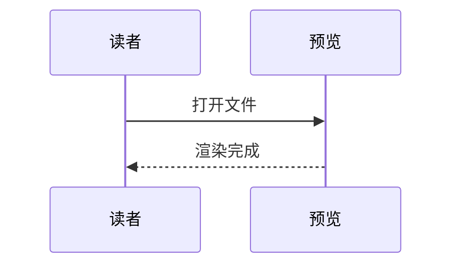

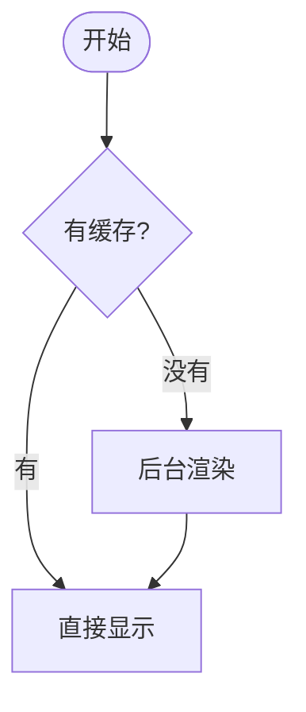

## HTML 块

HTML 注释不显示，但会占位：

<!-- 这一段注释不会出现在页面上 -->

<details>
<summary>折叠块在源码里是普通 HTML，页面上显示为代码</summary>
HTML 块按原样显示，不解析其中的标记。
</details>

媒体元素渲染成卡片：

<video src="missing-video.mp4"></video>


## 方言

同一份解析器，三套预设：

- `commonmark`：只认 CommonMark 核心语法；表格、任务列表、删除线、脚注、提示块之外的写法都按普通文字显示。
- `gfm`：在核心之上加表格、任务列表、删除线、裸地址、脚注、提示块与 front matter。
- `etaf`（默认）：在 `gfm` 之上再加定义列表、上下标、缩写、`$` 公式与表情短码。

在这份文件的开头写一行 `flavor: commonmark`，预览就只按核心语法解析；会话参数 `:flavor` 优先于文档里的声明，文档里的声明优先于全局变量 `etaf-md-preview-flavor`。

未启用的语法不会报错，只是照原样显示：这是「一份解析器、多套开关」的退化方式。

四种记号在同一句里：==高亮==、::check:: 图标、:kbd[Ctrl+B] 按键、:badge[v2]{.tip} 徽章，再加一个表情 :tada:。

配色各来一遍：==警告=={.warning}、==危险=={.danger}、==成功=={.success}、==提示=={.tip}、==信息=={.info}。

按键的三种写法：:kbd[Esc]、:kbd[Ctrl+Shift+P]、:kbd[Cmd+K]。

图标：::check::、::close::、::bell-off::、::search::。

徽章：:badge[稳定]{.success}、:badge[实验]{.warning}、:badge[废弃]{.danger}、:badge[新]{.info}。

# 二、块级容器

容器用 `:::name {属性}` 开、`:::` 关，属性只写下面表里列出的那些。


## 提示块

带固定强调色的说明块，七个名字一种写法。

**属性**

- `title`（字符串）：提示块的标题，省略用固定标题
- `collapsible`（布尔，默认 `false`）：允许收起；可选：`true` `false`
- `open`（布尔，默认 `true`）：收起时默认展开；可选：`true` `false`
- `background`（底色，默认 `quote`）：底色；可选：`none` `page` `raised` `sunken` `quote`
- `border-left-width`（长度，省略为 `3px` 细条）：左侧竖条宽度；可选：`ch` `lh` `%`

**例子**

:::warning {title="兼容性"}
这段只在 Emacs 30 及以上可用。
:::

:::note
省略标题时用这个强调值固定的标题。
:::

:::tip {title="小技巧"}
提示块也能写标题与正文。
:::

七个名字共用同一个视图，只是强调色和固定标题不同。

:::note {title="Note 是默认标题"}
标题可以覆盖。
:::

:::info
info 与 note 同色，名字不同。
:::

:::tip {title="提示"}
成功色。
:::

:::important
重要色。
:::

:::warning
警告色。
:::

:::caution
注意色。
:::

:::danger {title="危险"}
危险色。
:::

:::note {collapsible=true title="可收起的提示"}
点标题收起或展开。
:::


## 盒子

给一段内容换底色和左右留白。

**属性**

- `surface`（底色，默认 `none`）：外壳底色；可选：`none` `page` `raised` `sunken` `quote` `table-header` `table-stripe`
- `padding`（长度，默认 `2ch`）：左右内边距；可选：`ch` `lh` `%`
- `text-align`（对齐，默认 `start`）：内容的水平位置；可选：`start` `center` `end`
- `width`（长度）：自身宽度；可选：`ch` `lh` `%`

**例子**

:::box {surface=raised padding="3ch"}
盒子有底色、内边距与一圈细框。
:::

七种底色：

:::box {surface=none}
surface none：不画底色。
:::

:::box {surface=page}
surface page：页面底色。
:::

:::box {surface=raised}
surface raised：浮起一层的卡片面。
:::

:::box {surface=sunken}
surface sunken：凹下去的面。
:::

:::box {surface=quote}
surface quote：引用的面。
:::

:::box {surface=table-header}
surface table-header：表头的面。
:::

:::box {surface=table-stripe}
surface table-stripe：表格条纹的面。
:::

内边距与宽度：

:::box {padding="6ch" width="40ch"}
padding 6ch、width 40ch：盒子只占四十列。
:::

:::box {text-align=center}
text-align center：盒子里的字居中。
:::

:::box {text-align=end}
text-align end：盒子里的字靠右。
:::


## 卡片

带标题、摘要与强调色的块。

**属性**

- `title`（字符串，必填）：卡片标题
- `icon`（字符串）：标题前的图标名
- `description`（字符串）：标题下的一行
- `href`（字符串）：整张卡片可点
- `accent`（强调色，默认 `neutral`）：标题的强调色；可选：`neutral` `primary` `success` `warning` `danger` `important`
- `text-align`（对齐，默认 `start`）：内容的水平位置；可选：`start` `center` `end`
- `width`（长度）：自身宽度；可选：`ch` `lh` `%`

**例子**

:::card {title="缓存命中" description="一次缩放，不重画" accent=warning width="60ch"}
图片和矢量按页面尺寸缩放一次。

- 命中时读文件
- 未命中时画一次
:::

:::card {title="缓存命中" description="标题与摘要" icon="check"}
正文照常写：列表、代码、链接都能放。
:::

六种强调色：

:::card {title="neutral" accent="neutral"}
默认的强调色。
:::

:::card {title="primary" accent="primary"}
主色。
:::

:::card {title="success" accent="success"}
成功。
:::

:::card {title="warning" accent="warning"}
警告。
:::

:::card {title="danger" accent="danger"}
危险。
:::

:::card {title="important" accent="important"}
重要。
:::

整张卡片可点、限宽、内容居中：

:::card {title="打开 ETAF" description="整张卡片是一个链接" href="https://etaf.top/" width="40ch" text-align="center"}
点击卡片任何位置都会打开主页。
:::

:::columns {columns=2 divider=false}
:::col
:::card {title="带图标的卡片" icon="check" description="图标跟标题在同一行。"}
卡片正文。
:::
:::
:::col
:::card {title="没有图标的卡片" description="默认什么都不画。"}
:::
:::
:::


## 分栏

把内容横向分组；卡片网格与弹性布局都是它的写法。

**属性**

- `columns`（字符串，默认 `2`）：一行几栏，或一串轨道
- `gap`（长度，默认 `2ch`）：栏间距；可选：`ch` `lh` `%`
- `padding`（长度）：左右内边距；可选：`ch` `lh` `%`
- `min-width`（长度，默认 `24ch`）：每栏最小宽度；可选：`ch` `lh` `%`
- `align-items`（枚举，默认 `stretch`）：子块在交叉轴的对齐；可选：`start` `center` `end` `stretch`
- `justify-content`（枚举，默认 `start`）：子块在主轴的对齐；可选：`start` `center` `end` `between` `around`
- `wrap`（布尔，默认 `false`）：放不下时换行；可选：`true` `false`
- `divider`（布尔，默认 `true`）：栏与栏之间画一条竖线；可选：`true` `false`
- `align-self`（枚举，默认 `start`）：自身在父级里的水平位置；可选：`start` `center` `end`

子块 `col`：

- `grow`（数字，默认 `1`）：宽度份数

**例子**

:::columns {columns=2 gap="2ch"}
:::col
左栏第一段。

左栏第二段。
:::
:::col
右栏只有一段，但比左栏长一些，用来看两栏高度不一致时竖线怎么收。
:::
:::

:::columns {columns=3 gap="2ch"}
:::col
第一栏
:::
:::col
第二栏
:::
:::col
第三栏
:::
:::

两栏：

:::columns {columns=2}
:::col
左栏的一段话。
:::
:::col
右栏的一段话。
:::
:::

三栏、去掉栏间竖线：

:::columns {columns=3 divider=false}
:::col
第一栏
:::
:::col
第二栏
:::
:::col
第三栏
:::
:::

栏间距 6ch、左右留白 2ch：

:::columns {columns=2 gap="6ch" padding="2ch"}
:::col
左栏。
:::
:::col
右栏。
:::
:::

放不下就换行：

:::columns {columns=3 wrap=true min-width="20ch"}
:::col
一
:::
:::col
二
:::
:::col
三
:::
:::col
四
:::
:::

子块在交叉轴居中、主轴两端对齐：

:::columns {columns=2 align-items=center justify-content=between}
:::col
左
:::
:::col
右
:::
:::

:::columns {columns=2}
:::col
:::image-card {src="../tests/fixtures/preview-wide.png" title="网格里的第一张" width="38"}
:::
:::
:::col
:::image-card {src="../tests/fixtures/preview-media.png" title="网格里的第二张" width="38"}
:::
:::
:::

:::columns {columns=2}
:::col
:::link-card {href="https://etaf.top/" title="两张卡片并排" description="每一栏各放一张，卡片自己负责边界和底色。"}
:::
:::
:::col
:::link-card {href="https://github.com/emacs-taf" title="右栏的链接" description="link-card 在栏里自动铺满可用宽度。"}
:::
:::
:::

Plume 的 `flex` 和 `card-grid` 在这套语法里都是 `columns`：数字是等宽几栏，一串轨道是按比例或固定宽分栏，`wrap`、`gap`、`justify-content` 与它同名同义。

:::columns {columns=3 gap="2ch" divider=false}
:::col
:::card {title="等宽一" description="三栏等宽。"}
:::
:::
:::col
:::card {title="等宽二" description="三栏等宽。"}
:::
:::
:::col
:::card {title="等宽三" description="三栏等宽。"}
:::
:::
:::

:::columns {columns="22ch 22ch 22ch" gap="3ch" wrap=true divider=false}
:::col
:::card {title="固定宽一"}
:::
:::
:::col
:::card {title="固定宽二"}
:::
:::
:::col
:::card {title="固定宽三"}
:::
:::
:::col
:::card {title="换行的第四张"}
:::
:::
:::


## 对齐

把正文按一个方向排。

**属性**

- `:::left`：靠左
- `:::center`：居中
- `:::right`：靠右
- `:::justify`：两端对齐

**例子**

:::center
这一行居中。
:::

:::right
这一行靠右。
:::

:::justify
两端对齐适合较长的说明文字。它会把每一行的两端都排齐，只在最后一行留出自然的空隙，读起来像排过版的正文而不是随手写的段落。
:::


## 详情

标题一行，正文按需展开。

**属性**

- `title`（字符串）：收起时的标题
- `open`（布尔，默认 `false`）：默认展开；可选：`true` `false`

**例子**

:::details {title="展开看完整报错"}
```
Error: void-function etaf-md-open
```
:::

`open=true` 默认展开：

:::details {title="默认就展开" open=true}
这一块一进来就是展开的。
:::

:::details {title="默认收起的一块"}
这里的正文只在展开后出现。
:::

:::details {title="默认展开的一块" open=true}
打开页面时就能看到这段正文。
:::

:::accordion
:::collapse {title="第二块"}
这里同时只开一块。
:::
:::collapse {title="第一块" index=1 open=true}
`index` 决定显示顺序。
:::
:::

:::accordion {accordion=false}
:::collapse {title="可以同时打开的一"}
:::
:::collapse {title="可以同时打开的二" open=true}
这一块默认就展开，可以和上面那块一起开着。
:::
:::


## 折叠

一组可收起的块，默认只开一块。

**属性**

- `expand`（布尔，默认 `false`）：打开时所有块都展开；可选：`true` `false`
- `accordion`（布尔，默认 `true`）：同时只开一块；false 可以开多块；可选：`true` `false`

子块 `collapse`：

- `title`（字符串，必填）：收起时的标题
- `open`（布尔，默认 `false`）：默认展开；可选：`true` `false`
- `index`（数字）：显示顺序，省略按书写顺序

**例子**

:::accordion
:::collapse {title="完整的报错"}
```
后面的长文本放这里。
```
:::
:::collapse {title="版本差异"}
第二折的正文。
:::
:::

默认同时只开一块：

:::accordion
:::collapse {title="先看结论"}
结论写在最前面。
:::
:::collapse {title="再看原因"}
原因写在后面。
:::
:::

`accordion=false` 可以同时开多块：

:::accordion {accordion=false}
:::collapse {title="第一块"}
可以同时展开。
:::
:::collapse {title="第二块"}
两块互不影响。
:::
:::

`expand=true` 打开页面时全部展开：

:::accordion {expand=true}
:::collapse {title="全部展开的第一块"}
:::
:::collapse {title="全部展开的第二块"}
:::
:::

`index` 决定顺序，`open=true` 默认展开：

:::accordion {accordion=false}
:::collapse {title="后写的先出现" index=1 open=true}
index 小的排前面。
:::
:::collapse {title="后写的后出现" index=2}
index 大的排后面。
:::
:::


## 标签页

一行标签切换多段内容。

**属性**

（无属性）

子块 `tab`：

- `title`（字符串，必填）：标签文字
- `selected`（布尔，默认 `false`）：打开时选中这一页；可选：`true` `false`

**例子**

:::tabs
@tab 第一页
第一页的正文。
@tab 第二页
第二页的正文。
:::

子块是 `tab`，用 `@tab` 一行一个；`title` 必填，可以写在标记后面或花括号里，`selected` 选默认页。

:::tabs
@tab Emacs 29
Emacs 29 的写法。
@tab {title="Emacs 30+" selected=true}
Emacs 30 起的写法。
:::


## 代码标签页

一行标签切换多段代码，标签取语言名或标题。

**属性**

（无属性）

子块 `tab`：

- `title`（字符串）：标签文字，省略取围栏语言
- `selected`（布尔，默认 `false`）：打开时选中这一页；可选：`true` `false`

**例子**

:::code-tabs
@tab
```elisp
(etaf-md-open)
```
@tab
```python
print("hi")
```
:::


## 步骤

有序步骤，可带正文。

**属性**

- `start`（数字，默认 `1`）：起始编号
- `list-style`（枚举，默认 `decimal`）：记号；可选：`decimal` `bullet` `none`

子块 `step`：

- `title`（字符串，必填）：步骤标题

**例子**

:::steps {start=1}
:::step {title="定位"}
先用 `sample` 抓栈，别先猜。
:::
:::step {title="改因"}
改产生现象的那一层，不改它的结果。
:::
:::step {title="复验"}
同一个输入再跑一遍。
:::
:::

列表写法只带标题，正文用 `step` 子块。

:::steps {start=1}
1. 读源码，找出产生现象的那一层
2. 改那一层，不改它的结果
:::

:::steps
:::step {title="定位"}
先用 `sample` 抓栈，别先猜。
:::
:::step {title="改因"}
改产生现象的那一层，不改它的结果。
:::
:::

`start=0` 从零编号：

:::steps {start=0}
:::step {title="第零步"}
编号从零开始。
:::
:::step {title="第一步"}
:::
:::

`list-style=bullet`：

:::steps {list-style=bullet}
:::step {title="用圆点"}
:::
:::step {title="不用数字"}
:::
:::

`list-style=none`：

:::steps {list-style=none}
:::step {title="不画记号"}
:::
:::step {title="只留标题"}
:::
:::

也可以直接写有序列表，列表项文字就是步骤标题：

:::steps
1. 读源码，找出产生现象的那一层
2. 改那一层，不改它的结果
:::


## 时间线

按时间排的事件，每项可带状态。

**属性**

- `list-style`（枚举，默认 `bullet`）：记号的样式；可选：`decimal` `bullet` `none`
- `start`（数字，默认 `1`）：第一项的序号

子块 `event`：

- `title`（字符串，必填）：标题
- `time`（字符串）：时间文字
- `status`（枚举）：状态，决定圆点颜色并画成一个徽标；可选：`success` `warning` `danger` `info`

**例子**

:::timeline
:::event {time="2026-11-12" title="定位到慢在画图"}
`image-size` 会真的把图画出来。
:::
:::event {time="2026-11-13" title="改成读文件头" status="success"}
打开从 5.4 秒降到 0.33 秒。
:::
:::

默认圆点，`start=1`：

:::timeline
:::event {time="2026-11-12" title="定位到慢在画图"}
`image-size` 会真的把图画出来。
:::
:::event {time="2026-11-13" title="改成读文件头"}
打开从 5.4 秒降到 0.33 秒。
:::
:::

`list-style=decimal`、`start=3`：

:::timeline {list-style=decimal start=3}
:::event {title="第三项"}
:::
:::event {title="第四项"}
:::
:::

`list-style=none`：

:::timeline {list-style=none}
:::event {title="不画记号"}
:::
:::

四种状态：

:::timeline
:::event {title="成功" status="success"}
:::
:::event {title="警告" status="warning"}
:::
:::event {title="错误" status="danger"}
:::
:::event {title="说明" status="info"}
:::
:::


## 字段

一个参数一张卡，或列成字段表。

**属性**

- `name`（字符串）：参数名；写了就画成参数卡
- `type`（字符串）：类型注解
- `type-link`（字符串）：类型的链接地址
- `default`（字符串）：默认值
- `required`（布尔，默认 `false`）：必填；可选：`true` `false`
- `deprecated`（字符串）：弃用说明，写了显示弃用徽标
- `experimental`（字符串）：实验性说明，写了显示实验徽标
- `enum`（字符串）：可选值，用 | 或逗号分隔
- `unit`（字符串）：单位
- `format`（字符串）：格式
- `constraint`（字符串）：约束
- `since`（字符串）：引入版本
- `label-width`（长度）：名称列宽度，省略按最长的名称算；可选：`ch` `lh` `%`
- `separator`（枚举，默认 `colon`）：名称与值的分隔；可选：`colon` `none`

**例子**

一个参数的说明卡：名字一行，状态徽标跟在后面，类型、默认值和引入版本一行，正文就是说明。

:::field {name="text" type="string" default="空字符串" required=true since="0.1"}
要画成链接的文字，必填。
:::

:::field {name="width" type="number" default="46" unit="列" constraint="8 ≤ width ≤ 120" enum="8 | 16 | 46 | 120" format="整数"}
图片卡的最大列数，超出页面宽度时自动收窄。
:::

:::field {name="tabs" type="string" enum="npm | pnpm | yarn | bun | deno" deprecated="0.2" experimental="1.0"}
要显示的包管理器，逗号分隔；第二个参数已弃用，第四个还在试验。
:::

:::field {name="type-link" type="string" type-link="https://etaf.top/" since="0.3"}
类型名可以是一个链接，点它打开目标页。
:::

:::field
- 版本：12.3.0
- 渲染器：Chromium，常驻
- 缓存：`~/.cache/etaf-md/typeset`
:::

一个参数一张卡，属性：`name`、`type`、`type-link`、`default`、`required`、`deprecated`、`experimental`、`enum`、`unit`、`format`、`constraint`、`since`。

:::field {name="text" type="string" type-link="https://etaf.top/docs/" default="空字符串" required=true since="0.1"}
要画成链接的文字，必填。
:::

:::field {name="width" type="number" default="46" deprecated="改用 max-width" experimental="还没定稿" enum="24|32|46|64" unit="列" format="整数" constraint="8 到 120" since="0.2"}
图片卡的最大列数。
:::

不写 `name` 就是字段表，正文是一个列表，属性是 `label-width` 与 `separator`：

:::field {label-width="10ch"}
- 版本：12.3.0
- 渲染器：Chromium，常驻
- 缓存：`~/.cache/etaf-md/typeset`
:::

`separator=none` 去掉名称与值之间的冒号：

:::field {separator=none}
- 版本 12.3.0
- 渲染器 Chromium
:::

:::field
- 版本：12.3.0
- 渲染器：Chromium，常驻
- 缓存：`~/.cache/etaf-md/typeset`
:::


## 数字组

一排数字指标。

**属性**

- `columns`（数字，默认 `3`）：一行几个

子块 `stat`：

- `title`（字符串，必填）：说明文字
- `value`（字符串，必填）：数字文本

**例子**

:::stats
:::stat {title="打开" value="0.33 s"}
:::
:::stat {title="缩放" value="0.18 s"}
:::
:::stat {title="内存" value="349 MB"}
:::
:::

三列：

:::stats
:::stat {title="打开" value="0.33 s"}
:::
:::stat {title="缩放" value="0.18 s"}
:::
:::stat {title="内存" value="349 MB"}
:::
:::

两列：

:::stats {columns=2}
:::stat {title="页面" value="2300 行"}
:::
:::stat {title="耗时" value="1.2 s"}
:::
:::


## 文件树

带树线、注释与增删标记的目录树。

**属性**

- `title`（字符串）：树上方一行标题
- `lines`（布尔，默认 `true`）：画不画树线；可选：`true` `false`
- `icon`（枚举）：plume 的图标样式，文字页面里不画图标，只接受这个参数；可选：`simple` `colored`

**例子**

:::file-tree {title="lisp/"}
- lisp/
  - etaf-md-model.el
  - etaf-md-views.el
- etaf-md.el
:::

:::file-tree {title="lisp/"}
- **lisp/** # 渲染核心
  - **etaf-md-model.el** # 解析、派生与增量发布
  - etaf-md-views.el # 页面与媒体
  - ++ etaf-md-typeset.el # 这次新增的排版层
  - -- etaf-md-old.el # 已删除的旧实现
  - tests/
    - etaf-md-tests.el
- etaf-md.el
- …
:::

`lines=false` 不画树线；`icon` 只接受 plume 传来的值，文字页面里不画文件图标：

:::file-tree {lines=false icon="simple"}
- lisp
  - etaf-md-model.el
  - etaf-md-views.el
:::


## 对话

一问一答，按发送者对边。

**属性**

- `title`（字符串）：对话上方的标题

**例子**

:::chat {title="预览为什么还不刷新"}
{:2026-11-14 14:20}

{问}
预览为什么不刷新？

{.}
保存之后才刷新，改到一半不重排。
:::


## 表格

带标题、行列高亮与复制行的表格。

**属性**

- `title`（字符串）：表格上方一行标题
- `highlight-rows`（字符串）：高亮的行号，空格分隔
- `highlight-columns`（字符串）：高亮的列号，空格分隔
- `highlight-cells`（字符串）：高亮的单元格，写成 行:列，空格分隔
- `align`（枚举）：整张表的对齐，盖过 text-align；可选：`left` `center` `right`
- `copy`（布尔，默认 `false`）：在标题下画一个复制整表的一行；可选：`true` `false`
- `highlight`（强调色，默认 `warning`）：高亮用哪个强调值；可选：`neutral` `primary` `success` `warning` `danger` `important`
- `background`（底色，默认 `page`）：表格底色；可选：`none` `page` `raised` `sunken` `quote` `table-header` `table-stripe`
- `color`（颜色，默认 `foreground`）：表格文字色
- `header-background`（底色，默认 `table-header`）：表头底；可选：`none` `page` `raised` `sunken` `quote` `table-header` `table-stripe`
- `stripe-background`（底色，默认 `table-stripe`）：条纹底；可选：`none` `page` `raised` `sunken` `quote` `table-header` `table-stripe`
- `text-align`（对齐，默认 `start`）：单元格文字位置；可选：`start` `center` `end`
- `margin-top`（长度，默认 `0ch`）：与上一块的距离；可选：`ch` `lh` `%`
- `margin-bottom`（长度，默认 `0ch`）：与下一块的距离；可选：`ch` `lh` `%`

**例子**

:::table {title="三个版本的打开耗时" align=center}
| 版本 | 耗时 | 内存 |
| --- | --- | --- |
| 0.1.9 | 5.4 s | 380 MB |
| 0.2.0 | 0.33 s | 92 MB |
| 0.3.0 | 0.18 s | 74 MB |
:::

:::table {title="高亮一行、一列和一个格子" highlight-rows="2" highlight-columns="3" highlight-cells="3:1" copy=true}
| 版本 | 耗时 | 内存 |
| --- | --- | --- |
| 0.1.9 | 5.4 s | 380 MB |
| 0.2.0 | 0.33 s | 92 MB |
| 0.3.0 | 0.18 s | 74 MB |
:::

:::table {title="只有两列的表"}
| 名称 | 值 |
| --- | --- |
| 缓存 | 命中 |
:::

标题加复制行：

:::table {title="三个版本的打开耗时" copy=true}
| 版本 | 耗时 | 内存 |
| --- | --- | --- |
| 0.1.9 | 5.4 s | 380 MB |
| 0.2.0 | 0.33 s | 92 MB |
| 0.3.0 | 0.18 s | 74 MB |
:::

高亮行、列、格子：

:::table {highlight-rows="2" highlight-columns="3" highlight-cells="4:2" highlight=warning}
| 版本 | 耗时 | 内存 |
| --- | --- | --- |
| 0.1.9 | 5.4 s | 380 MB |
| 0.2.0 | 0.33 s | 92 MB |
| 0.3.0 | 0.18 s | 74 MB |
:::

`align=center` 整表居中、`text-align=center` 单元格居中：

:::table {align=center text-align=center}
| 名称 | 值 |
| --- | --- |
| 缓存 | 命中 |
:::

`highlight=success`：

:::table {highlight-rows="2" highlight=success}
| 步骤 | 结果 |
| --- | --- |
| 定位 | 完成 |
| 修复 | 完成 |
:::

`background=sunken`、`header-background=raised`、`stripe-background=quote`：

:::table {background=sunken header-background=raised stripe-background=quote}
| 版本 | 状态 |
| --- | --- |
| 0.2.0 | 旧 |
| 0.3.0 | 新 |
:::

`margin-top` 与 `margin-bottom`：

:::table {margin-top="1lh" margin-bottom="1lh"}
| 上 | 下 |
| --- | --- |
| 留 | 空 |
:::

:::table {title="打开耗时" highlight-rows="3" highlight=warning}
| 版本 | 耗时 |
| --- | --- |
| 0.1.9 | 5.4 s |
| 0.2.0 | 0.33 s |
:::


## 演示窗口

带标题栏的窗口框。

**属性**

- `title`（字符串）：标题栏文字
- `height`（长度）：内容区高度；可选：`ch` `lh` `%`
- `gap`（长度）：标题栏与内容之间的空行；可选：`ch` `lh` `%`
- `no-padding`（布尔，默认 `false`）：内容区不留内边距；可选：`true` `false`

**例子**

:::window {title="etaf-md-preview"}
一段界面截图或者一段文字。
:::

:::window {title="etaf-md.el"}
窗口只画标题栏，内容照常写。
:::

固定高度、标题栏与内容之间空一行、内容不留内边距：

:::window {title="固定高度" height="6lh" gap="1lh" no-padding=true}
```
(etaf-md-open "笔记")
```
:::

:::window {title="带间距的窗口" gap="1lh" height="6lh"}
窗口内容区可以定高，`gap` 在标题栏下留一行。
:::

:::window {title="不留内边距" no-padding=true height="4lh"}
`no-padding` 让内容贴着边框。
:::


## 源码树

左边文件列表，右边选中文件的代码。

**属性**

- `height`（数字）：代码区行数，超出可滚动，默认 18

子块 `file`：

- `title`（字符串，必填）：文件路径

**例子**

:::code-tree {height=10}
@file lisp/etaf-md-env.el
```elisp
(defun etaf-md--hairline (env)
  (etaf-theme-token
   :ui-panel-border
   (or (etaf-md--palette-value (etaf-md-env-palette env) :border)
       "#3a3f4b")))
```
@file lisp/etaf-md-nodes.el
```elisp
(etaf-md--define-shipped 'chat
  :name "chat"
  :summary "一问一答的对话，不画气泡"
  :attrs '((title :type string)))
```
:::

:::code-tree {height=20}
@file Makefile
```make
.DEFAULT_GOAL := check
.NOTPARALLEL:
EMACS ?= emacs
# Providers are siblings in the workspace and in a standalone clone;
# override PROVIDER_ROOT to pin another checkout.
PROVIDER_ROOT ?= ..
LOAD_PATH = -L . -L lisp -L tests -L $(PROVIDER_ROOT)/etaf -L $(PROVIDER_ROOT)/etaf-ui -L $(PROVIDER_ROOT)/ebox -L $(PROVIDER_ROOT)/ecss
SOURCES = $(wildcard lisp/*.el)
SOURCES += etaf-md.el
SOURCES += $(wildcard examples/*.el)
SOURCES += scripts/etaf-md-gui-probe.el
SOURCES += benchmarks/performance-scenarios.el

.PHONY: compile load check clean structure-check setup-hooks acceptance api-check test benchmark mermaid-check

compile:
	rm -f *.elc lisp/*.elc tests/*.elc examples/*.elc scripts/*.elc
	$(EMACS) -Q --batch $(LOAD_PATH) \
		--eval '(setq load-prefer-newer t byte-compile-error-on-warn t)' \
		--eval '(require (quote cl-lib))' \
		--eval '(unless (cl-every (function byte-compile-file) (quote ($(foreach file,$(SOURCES),"$(file)")))) (kill-emacs 1))'

load: compile
	$(EMACS) -Q --batch $(LOAD_PATH) --eval '(require (quote etaf-md))' --eval '(princ "etaf-md load OK\n")'

check: structure-check compile acceptance api-check
```
@file lisp/etaf-md-env.el
```elisp
(defun etaf-md--paint (node env)
  "Return the view ENV's definition gives NODE, or a failure line."
  (let* ((type (etaf-md-node-type node))
         (definition (etaf-md-node-definition type))
         (problems (and definition (plist-get definition :view)
                        (etaf-md--all-problems node))))
    (cond
     (problems
      (etaf-md--failure-view
       env (or (etaf-md-node-source node) "") (cadr (car problems))))
     ((and definition (plist-get definition :view))
      (let ((inner (etaf-md-env-create
                    :session (etaf-md-env-session env)
                    :node node
                    :width (etaf-md-env-width env)
                    :state (etaf-md-env-state env)
                    :palette (etaf-md-env-palette env)
                    :theme (etaf-md-env-theme env)
                    :block (etaf-md-node-block node))))
        (funcall (plist-get definition :view) inner)))
     ;; A Markdown block the new model does not define yet keeps the painter
     ;; it has today; only a container with no definition is a failure,
     ;; because a container cannot be painted without one.
     ((and (etaf-md-node-block node)
           (not (eq (plist-get (etaf-md-node-block node) :type) 'container)))
      (etaf-ui-markdown-view-block
       (etaf-md-node-block node)
       ;; A block painted below a container keeps the page services: media,
```
@file lisp/etaf-md-views.el
```elisp
    (warning . "警告") (caution . "小心"))
  "Chinese labels of the GitHub alert kinds, for ENV's `:alert-labels'.")

(defconst etaf-md--video-extensions
  '("mp4" "mov" "m4v" "webm" "avi" "mkv" "ogv" "mpg" "mpeg" "wmv" "flv" "3gp")
  "File extensions rendered as a video card.")

(defun etaf-md--env-color (env key)
  "Return ENV's color for semantic KEY.
ENV's face-derived `:palette', when present, wins over the named theme; an
unknown key in either source signals `etaf-md-error'."
  (if-let* ((palette (plist-get env :palette)))
      (or (cdr (assq key palette))
          (signal 'etaf-md-error
                  (list (format "Unknown markdown preview color: %S" key))))
    (etaf-md-color key (plist-get env :theme))))

(defconst etaf-md--meta-labels
  '(("author" . "作者") ("date" . "日期") ("version" . "版本")
    ("license" . "许可") ("status" . "状态"))
  "Front matter keys shown in the document header, with their labels.")

(defun etaf-md--meta-tags (meta)
  "Return the tag list of front matter META.
Both `[a, b]' and `a, b' spellings are accepted."
  (let ((raw (cdr (assoc "tags" meta))))
    (when (and raw (not (string-empty-p raw)))
      (let ((raw (replace-regexp-in-string "[][]" "" raw)))
```
@file lisp/etaf-md-nodes.el
```elisp
    (open              :type boolean :default t   :doc "收起时默认展开")
    (background        :type surface :default quote :doc "底色")
    (border-left-width :type length :default "1ch" :doc "左侧竖条宽度"))
  "Attributes every callout name shares.")

(defun etaf-md--toggle-line (label color command)
  "Return LABEL painted in COLOR as a focusable disclosure line.
COMMAND runs when the line is activated."
  (etaf-node 'box
             (list :color color :font-weight 'bold :on-press command)
             (list (etaf-node 'text nil (list label)))))

(defun etaf-md--callout-open-p (env)
  "Return non-nil when ENV's callout shows its body."
  (if (etaf-md-attr env :collapsible)
      (etaf-md-block-state env :open (etaf-md-attr env :open))
    t))

(defun etaf-md--callout-view (env)
  "Paint a callout; the five names share this view."
  (let* ((accent (etaf-md--callout-accent (etaf-md-type env)))
         (title (or (etaf-md-attr env :title)
                    (alist-get (etaf-md-type env) etaf-md--callout-titles)))
         (open (etaf-md--callout-open-p env))
         (collapsible (etaf-md-attr env :collapsible)))
    (etaf-node
```
@file tests/etaf-md-tests.el
```elisp
;;; etaf-md-tests.el --- Acceptance tests for etaf-md -*- lexical-binding: t; -*-

;; SPDX-License-Identifier: GPL-3.0-or-later

;;; Commentary:
;;
;; Public behaviour tests.  Every scenario drives the previewer through the
;; interfaces declared in `etaf-md.el'.  Rendering scenarios mount a
;; real runtime in a batch Emacs and read the visible buffer back, so they
;; assert what a reader sees instead of internal parse structures.

;;; Code:

(require 'ert)
(require 'cl-lib)
(require 'outline)
(require 'markdown-mode nil t)
(require 'etaf)
(require 'etaf-md)

(defconst etaf-md-tests--directory
  (file-name-directory (or load-file-name buffer-file-name))
  "Directory of this test file, resolved while it is loaded.")

(defun etaf-md-tests--fixture (name)
  "Return the absolute path of fixture NAME."
```
@file scripts/etaf-md-gui-probe.el
```elisp
;;; etaf-md-gui-probe.el --- Drive and inspect a live preview -*- lexical-binding: t; -*-

;; SPDX-License-Identifier: GPL-3.0-or-later

;;; Commentary:
;;
;; The preview's typography can only be judged in a real graphical frame:
;; heading scales, the reading measure, media grids and link hit areas depend
;; on the frame's fonts and pixel metrics.  This file is the maintained probe
;; a GUI check loads, so probes stop being throwaway files that bypass the
;; byte-compilation gate.
;;
;; Load it in a graphical Emacs with this repository and the provider roots on
;; `load-path', then:
;;
;;   (etaf-md-gui-open "README.md" "150x44")  ; open at a frame size
;;   (etaf-md-gui-status)                     ; one-line state for logs
;;   (etaf-md-gui-keys "nt")                  ; real keys through the loop
;;   (etaf-md-gui-follow "appended by a tool")  ; write the source
;;   (etaf-md-gui-follow-report "appended by a tool" LINE) ; then wait
;;   (etaf-md-gui-check)                      ; invariants; nil when healthy
;;   (etaf-md-gui-close)                      ; release the preview buffer
;;
;; Nothing here is part of the package's public API.
```
:::

:::code-tree {height=8}
@file etaf-md.el
```elisp
;;; etaf-md.el --- Modern Markdown preview in ETAF -*- lexical-binding: t; -*-

;; SPDX-License-Identifier: GPL-3.0-or-later
;; Author: ETAF contributors
;; Version: 0.2.0
;; Package-Requires: ((emacs "29.1") (etaf "0.3.0") (etaf-ui "0.2.0"))
;; Keywords: hypermedia, docs
;; URL: https://github.com/emacs-taf/etaf-md

;;; Commentary:

;; Public API
;;
;; Load this package with (require 'etaf-md) after adding this
;; repository and the ETAF, ETAF UI, Ebox and ECSS roots to `load-path'.  The
;; previewer renders a local Markdown document as a modern reading view: a
;; centered measure with a typographic heading scale, fenced code blocks with
;; language tags, blockquotes, nested lists, task list markers, pipe tables,
;; thematic breaks, footnotes, clickable links and inline images, plus local
;; image and video cards whose poster frame is prepared through ETAF's image
;; Host; activating a video card plays it inline through ETAF's video
;; Component.  Front matter is stripped into document metadata.  The whole
;; document publishes into one buffer with native Emacs scrolling, isearch
;; and window splitting, so no pane owns a private scrolling model.
```
@file lisp/etaf-md-theme.el
```elisp
;;; etaf-md-theme.el --- Palettes for etaf-md -*- lexical-binding: t; -*-

;; SPDX-License-Identifier: GPL-3.0-or-later

;;; Commentary:
;;
;; Internal palettes of the markdown previewer.  A palette is a plain alist of
;; semantic color keys; the views read every color through
;; `etaf-md-color', so both palettes share one layout and a palette
;; change never leaks a half-updated set of colors.

;;; Code:

(require 'cl-lib)
(require 'etaf-ui)

(defconst etaf-md-themes
  '((dark . ((:bg . "#191a1c")
             (:ink . "#e6edf3")
             (:muted . "#9198a1")
             (:faint . "#6e7681")
             (:accent . "#4493f8")
             (:accent-soft . "#152c4d")
             (:border . "#303338")
```
@file tests/etaf-md-tests.el
```elisp
(defconst etaf-md-tests--directory
  (file-name-directory (or load-file-name buffer-file-name))
  "Directory of this test file, resolved while it is loaded.")

(defun etaf-md-tests--fixture (name)
  "Return the absolute path of fixture NAME."
  (expand-file-name (concat "fixtures/" name) etaf-md-tests--directory))

(defun etaf-md-tests--mount (session)
  "Mount SESSION in a fresh buffer and return that buffer."
  (etaf-mount (generate-new-buffer " *md-preview-test*")
              (etaf-md-view session)
              '(:viewport-width 900 :viewport-height 60)))

(defmacro etaf-md-tests--with-mount (session &rest body)
  "Mount SESSION, run BODY in its buffer, and always kill the buffer."
  (declare (indent 1) (debug t))
  `(let ((buffer (etaf-md-tests--mount ,session)))
     (unwind-protect
         (with-current-buffer buffer ,@body)
```
:::


## npm 命令

把 npm 命令改写成别的包管理器。

**属性**

- `tabs`（字符串）：要显示的包管理器，逗号分隔

**例子**

:::npm-to
```sh
npm install -D etaf-md
npm run build
npm uninstall old-package
npm create vue my-app
```
:::

:::npm-to {tabs="npm,pnpm"}
```sh
npm install vue
```
:::

:::npm-to {tabs="pnpm,bun"}
```sh
npm run dev
npx create-vue my-app
```
:::

:::npm-to
```sh
npm ci
npm init
npm install vue && npm run build
```
:::

:::npm-to {tabs="npm,pnpm,yarn,bun"}
```sh
npm install etaf-md
npm run build
npm uninstall foo
npm create vite
npx etaf-md
```
:::

只显示 yarn 与 deno：

:::npm-to {tabs="yarn,deno"}
```sh
npm install etaf-md
npm run build
npm ci
```
:::


## 嵌套与围栏

容器里再放容器，以及围栏里出现的同名字样。

:::card {title="外层卡片" description="里面再放盒子和分栏"}
:::box {surface=sunken}
卡片里的盒子。
:::

:::columns {columns=2}

:::col
嵌套左栏
:::

:::col
嵌套右栏
:::

:::
:::

下面这段是代码，不是容器：

```markdown
:::card {title="这是代码"}
:::
```


# 三、站点组件


## 首屏

站点首页的大块：标题、摘要、行动链接与正文。

**属性**

- `title`（字符串）：主标题
- `description`（字符串）：标题下的摘要
- `href`（字符串）：行动链接地址
- `accent`（强调色，默认 `primary`）：标题的强调色；可选：`neutral` `primary` `success` `warning` `danger` `important`
- `background`（底色，默认 `raised`）：底色；可选：`none` `page` `raised` `sunken` `quote` `table-header` `table-stripe`

**例子**

:::home-box {title="把文档当页面读" description="一个首屏大块：强调标题、摘要、行动链接和正文都在里面。" href="https://etaf.top/"}
首屏里的正文照常写，列表、代码和链接都能放。
:::

:::home-box {title="只有标题的首屏"}
标题以外的参数都省略时，只剩标题和正文。
:::

:::home-box {title="换一种强调色" description="accent 可以取 success、warning、danger、important 或 neutral。" accent="success"}
默认 raised 底色配合绿色强调标题。
:::

:::home-box {title="换一种强调色" description="accent 可以取 success、warning、danger、important 或 neutral。" accent="success" background="sunken"}
底色同时换成 sunken。
:::


## 图片卡片

图片加标题与说明，边框贴着图片。

**属性**

- `src`（字符串，必填）：图片路径，相对路径按文档解析
- `title`（字符串）：图片下的标题
- `description`（字符串）：标题下的说明
- `href`（字符串）：整张卡片可点，跳到这个地址
- `width`（数字）：图片列数上限，默认 46

**例子**

:::image-card {src="../tests/fixtures/preview-wide.png" title="完整的预览" description="图片在上，标题和说明在下；整张卡片都能点。" href="https://etaf.top/"}
:::

:::image-card {src="../tests/fixtures/preview-media.png" title="只有标题" width="40"}
:::

:::image-card {src="../tests/fixtures/wide-400x100.png" width="52"}
:::

:::image-card {src="../tests/fixtures/preview-media.png" title="媒体页" description="点击打开 ETAF" href="https://etaf.top/" width=30}
:::


## 链接卡片

一张可点的链接卡。

**属性**

- `href`（字符串，必填）：跳转地址
- `title`（字符串，必填）：卡片标题
- `description`（字符串）：标题下的说明

**例子**

:::link-card {href="https://etaf.top/" title="ETAF 主页" description="整张卡片都可以点，箭头下面是目标地址。"}
:::

:::link-card {href="https://github.com/emacs-taf" title="只有标题和地址"}
:::


## npm 徽章

包名、版本与下载量的小徽章。

**属性**

- `name`（字符串，必填）：包名
- `version`（字符串）：版本号，省略就不画
- `downloads`（字符串）：下载量文字，省略就不画

**例子**

:::npm-badge {name="etaf-md" version="0.1.0" downloads="1.2k"}
:::

:::npm-badge {name="etaf-ui"}
:::

:::npm-badge {name="etaf" version="0.9.2"}
:::


## 二维码

把一段文本画成二维码。

**属性**

- `text`（字符串，必填）：要编码的文本
- `title`（字符串）：二维码上方的说明

**例子**

:::qrcode {text="https://etaf.top/" title="扫码打开 etaf.top"}
:::

:::qrcode {text="ETAF 把文档当页面读"}
:::

:::qrcode {text="https://github.com/emacs-taf/etaf-md/blob/main/docs/extensions.zh-CN.md" title="长一点的地址也能装下"}
:::


## 轮播

一页一页切换的内容块。

**属性**

（无属性）

子块 `slide`：

- `title`（字符串）：切换条上的文字
- `selected`（布尔，默认 `false`）：默认停在这一页；可选：`true` `false`

**例子**

:::swiper
@slide {title="宽图"}

@slide {title="第二张"}
第二页是文字，轮播不只能放图片。
@slide {title="第三张"}
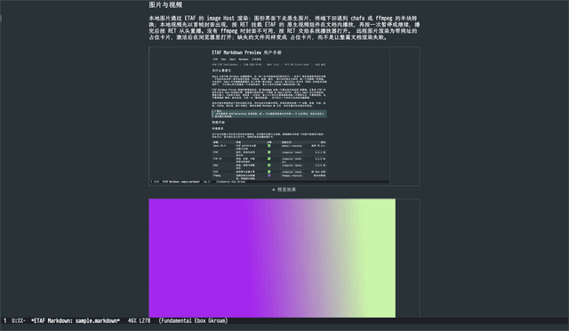
:::

:::swiper
@slide

@slide {selected=true}
第二页默认打开。
:::


# 四、图表

## 流程图：形状与分组

每种形状有含义：圆角是开始结束，菱形是判断，圆柱是存储，子程序是调用。两条分支分别用 `classDef` 上了色，颜色从页面的强调色取。

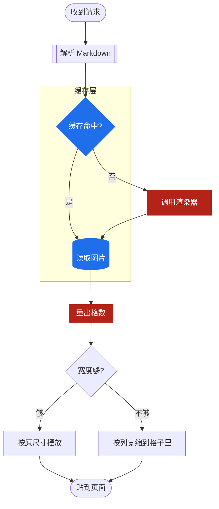

横向排布用于一条主线的流程，节点少的时候比竖排紧凑：


## 时序图：一次主题切换

`autonumber` 给消息编号；`alt`、`opt`、`loop` 表达分支与重复；`activate` 画出演进期。

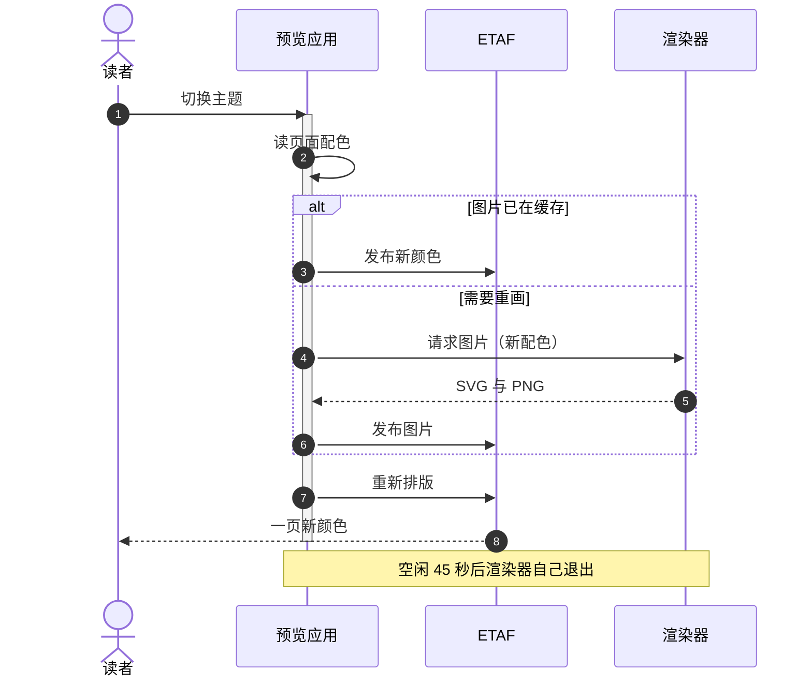

## 类图：泛型与关系

继承、组合、聚合、依赖各有一条线；`~T~` 写泛型参数，`{abstract}`、`{static}` 写在成员上。

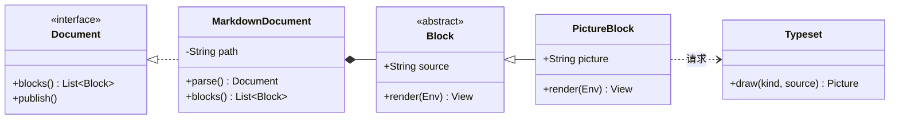

## 状态图：复合状态与分叉

`state ... as` 起别名，`<<fork>>`、`<<join>>` 画并行，`--` 分出两条同时进行的路径。

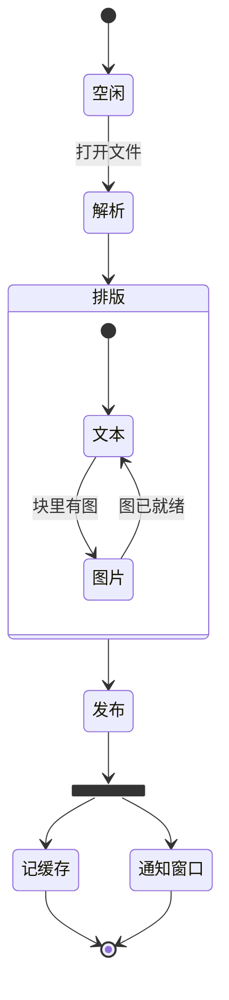

## ER 图：主键与外键

`PK`、`FK` 标出键，`||--o{` 这样的写法表示一对多，注释写在各列后面。

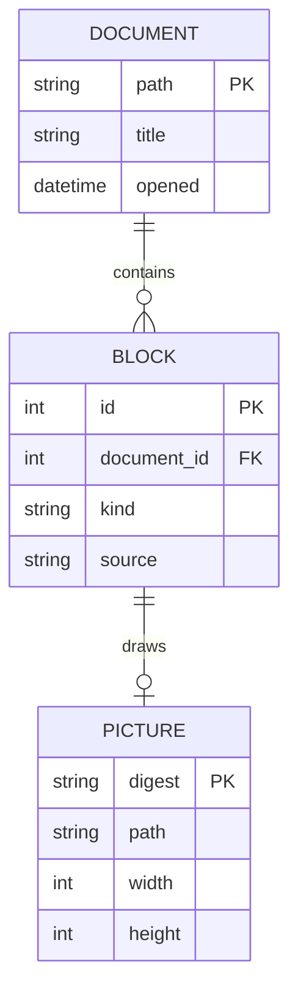

## 甘特图：里程碑与关键路径

`done`、`active`、`crit` 是任务状态；`milestone` 是零长度节点；`excludes` 跳过周末。

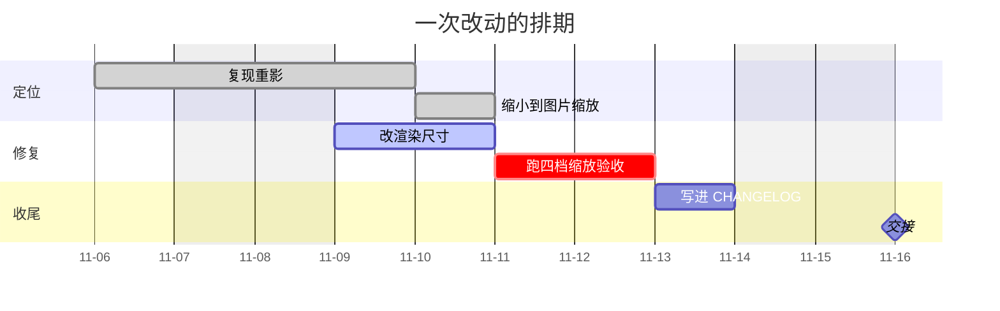

## 饼图：带数值

`showData` 把每段的数值写在标签里，适合占比一眼看明白。

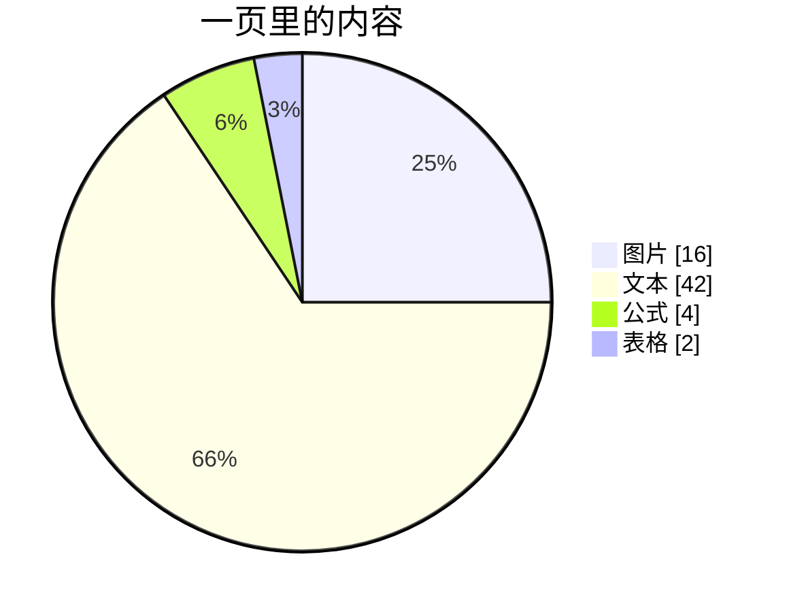

## 需求图：验证与满足

`requirement` 写需求，`element` 写实现，`satisfies`、`verifies` 连起来。

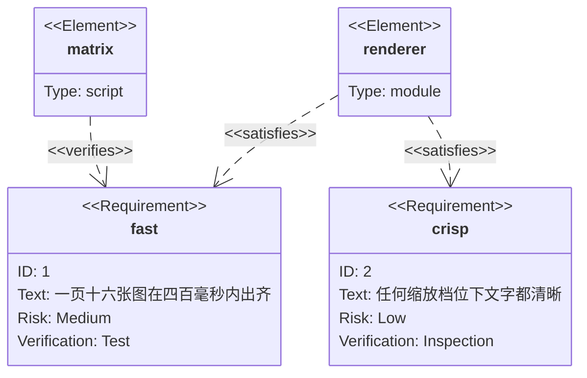

## Git 图：分支与补丁

`branch`、`checkout`、`merge`、`cherry-pick` 各画一种线；`tag` 标版本。
[I[I]]


## 旅程图：一段使用过程

`section` 分区，每行是「任务: 分数: 角色」，分数决定曲线的起伏。

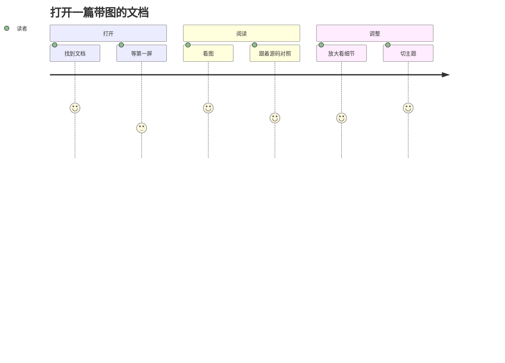

## 思维导图：形状与图标

根节点用圆形，第二层用不同形状区分职责，`::icon` 挂图标。

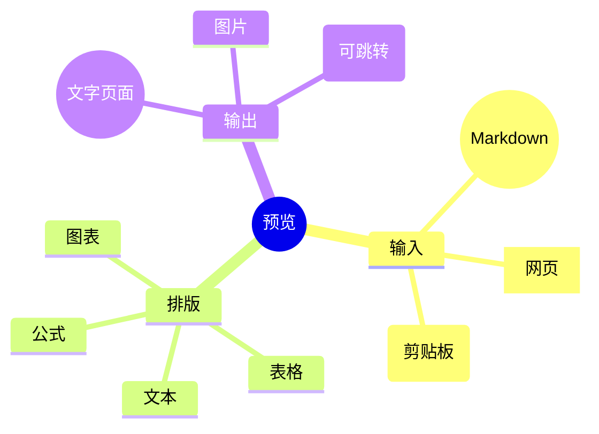

## 时间线：按年份分组

`section` 分期，`时间 : 事件 : 事件` 一行可以写多条。

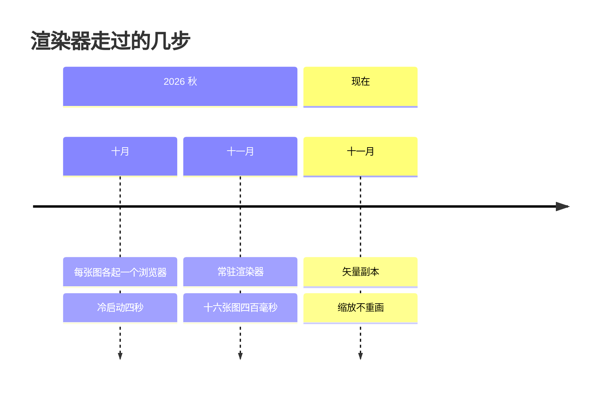

## 象限图：两个维度

`x-axis`、`y-axis` 给范围和两端名称，四个 `quadrant` 写判断，点用 `[x, y]` 定位。

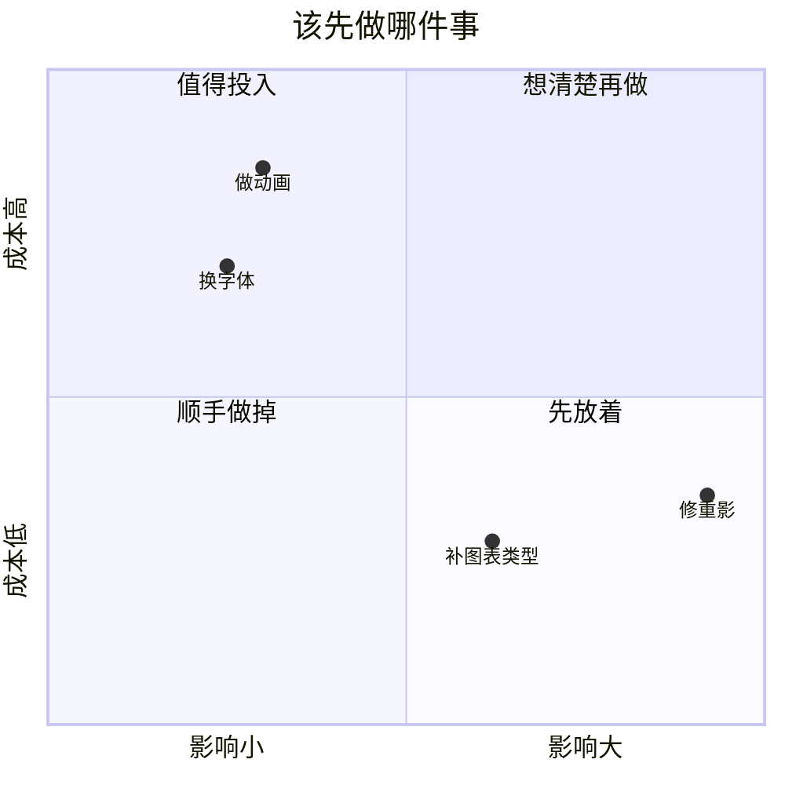

## 桑基图：能量的去向

第一列写来源，第二列写去向，第三个数是量；同一节点自动汇总。节点名要用拉丁字母，mermaid 的桑基图只接受这种名字。

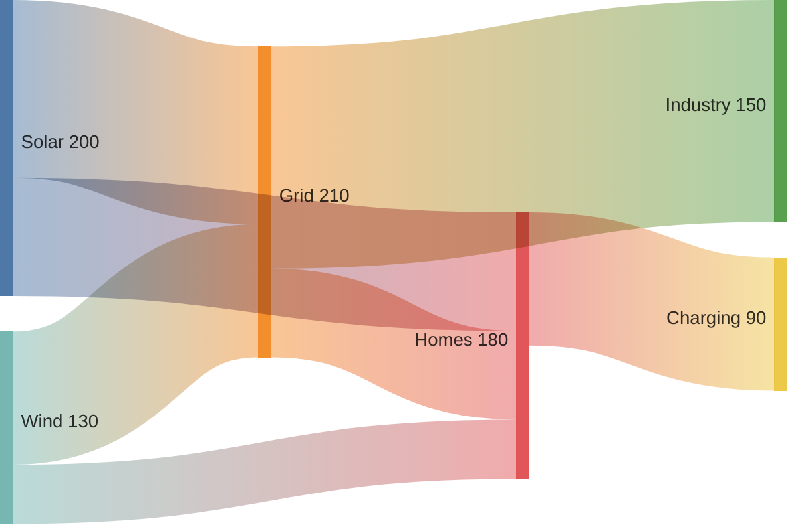

## XY 图：柱与线

柱和线是两个序列，各取一种颜色；`x-axis` 写分类，`y-axis` 写范围和单位。

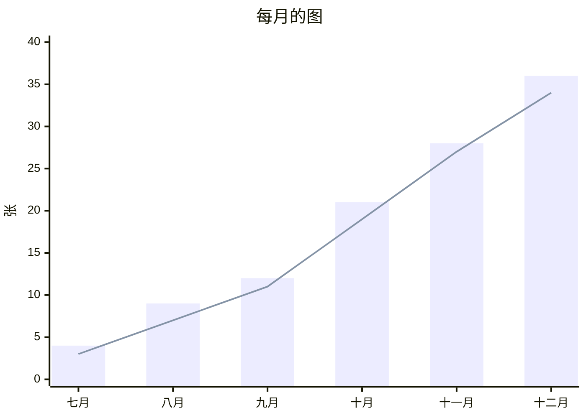

## 块图：按列摆

`columns` 定列数，`块:2` 占两列，`space` 留空，箭头画出数据流向。

```mermaid
block-beta
  columns 4
  source["源文件"]:2  theme["主题"]:2
  space:4
  parse["解析"]:2  paint["配色"]:2
  space:4
  page["一页"]:4
  source --> parse
  theme --> paint
  parse --> page
  paint --> page
```

## 数据包图：字段与位宽

`起-止: "名称"` 给每个字段的位置，宽度自然就是字段的位数。

```mermaid
packet-beta
  0-15: "源端口"
  16-31: "目的端口"
  32-63: "序号"
  64-95: "确认号"
  96-99: "首部长度"
  100-105: "保留"
  106-111: "标志位"
  112-127: "窗口"
  128-159: "校验和与紧急指针"
```

## 看板：三列状态

列名写在方括号里，卡片可以带负责人与优先级。

```mermaid
kanban
  待办
    t1["补齐图表类型"]
    t2["写这一页"]
  进行中
    t3["修图片缩放"]
  已完成
    t4["渲染器常驻"]
    t5["矢量副本"]
```

## 架构图：分组与服务

`group` 画边界，`service` 写服务，`in` 表示属于哪个组，`A:R -- L:B` 连两个端口。

```mermaid
architecture-beta
  group app(cloud)[预览应用]
  service page(server)[页面] in app
  service typeset(server)[排版] in app
  service cache(database)[缓存] in app
  group draw(cloud)[渲染]
  service chromium(server)[Chromium] in draw
  page:R -- L:typeset
  typeset:R -- L:cache
  typeset:B -- T:chromium
```

## 雷达图：两组对比

`axis` 定维度，`curve` 给每组打分；两个序列用两种颜色，填充半透明。

```mermaid
radar-beta
  title 预览的几个方面
  axis speed["速度"], sharp["清晰"], steady["稳定"], cost["成本"]
  curve now["当前"]{9, 9, 8, 6}
  curve goal["目标"]{9, 10, 9, 8}
```

## 矩形树图：面积即数量

嵌套一层就是分组，数值决定面积，标签自动缩放。

```mermaid
treemap-beta
"一页的内容"
    "正文": 42
    "图表": 16
    "公式": 4
    "表格": 2
    "代码": 6
```

## C4：系统上下文

`Person`、`System`、`System_Ext` 画角色与系统，`Rel` 写关系，`Boundary` 圈出边界。

```mermaid
C4Context
  title 预览在系统里的位置
  Person(reader, "读者", "读文档的人")
  Boundary(app, "预览应用") {
    System(preview, "Markdown 预览", "把源码画成页面")
    System(renderer, "渲染器", "把图与公式画成图片")
  }
  System_Ext(editor, "编辑器", "改源码")
  Rel(reader, preview, "阅读")
  Rel(editor, preview, "保存后刷新")
  Rel(preview, renderer, "请求图片")
```

## 公式：行内与独立

行内公式跟着句子走，例如页面宽度按 $w = \lceil p / c \rceil$ 换算成格数，其中 $p$ 是像素宽，$c$ 是字符宽。独立公式单独成行，居中，上下留一行空白。

$$
\text{行高} = \max_{g \in G}\bigl(\text{ascent}(g) + \text{descent}(g)\bigr)
$$

矩阵与分段函数：

$$
A = \begin{pmatrix}
a_{11} & a_{12} & a_{13} \\
a_{21} & a_{22} & a_{23} \\
a_{31} & a_{32} & a_{33}
\end{pmatrix},
\qquad
f(x) = \begin{cases}
x^2, & x \ge 0, \\
-x, & x < 0.
\end{cases}
$$

求和、极限与偏导写在一行里也不挤：

$$
\sum_{i=1}^{n} \frac{1}{i^2} = \frac{\pi^2}{6},
\qquad
\lim_{h \to 0} \frac{f(x+h) - f(x)}{h} = \frac{\partial f}{\partial x}
$$

## 表格与提示块

| 图表 | 参数 | 用在哪 |
| --- | --- | --- |
| 流程图 | `classDef`、子图 | 流程、调用链 |
| 时序图 | `autonumber`、`alt` | 交互过程 |
| 甘特图 | `done`、`crit` | 排期 |
| 象限图 | 轴范围、点坐标 | 取舍 |

> [!NOTE]
> 图里的颜色都来自页面：切到亮色、暗色或 sepia，图上每个字仍然清楚。

> [!WARNING]
> 语法错的块不会被记成永久失败，改对源码就会重新画。

## 代码、引用与清单

```elisp
(defun etaf-md-preview--typeset-grid (path max-columns)
  "Return the (COLUMNS . ROWS) grid for the picture at PATH."
  (cons (min max-columns (round (/ (car (etaf-md-preview--image-pixels path))
                                   (float (car (etaf-md-preview--cell-metrics))))))
        nil))
```

> 图片的纵向几何只有一个所有者，就是 Emacs 的排版结果。

- [x] 十几种图在三种配色下都能读
- [x] 切换缩放不重画矢量
- [ ] 图表在窄窗口里自动缩到列宽

## 自定义配色

图里可以自己给颜色，用 init 指令覆盖默认配色：

```mermaid
%%{init: {"themeVariables": {"mainBkg": "#ff00aa", "primaryTextColor": "#ffffff"}}}%%
flowchart LR
  A[指令给底色] --> B[节点]
  B --> C[连线]
```

写在源码开头的 front matter 也一样：

```mermaid
---
config:
  themeVariables:
    mainBkg: "#00aaff"
    primaryTextColor: "#ffffff"
---
flowchart LR
  A[本文给底色] --> B[节点]
  B --> C[连线]
```

这两种写法都优先于预览自己的配色，所以一页里可以有几块不同样子的图。

# 五、检查清单

- 每一类的语法、全部属性与每个可选值都在右边出现。
- 没有失败行，也没有落到源码的容器。
- 代码块的标题、行号、行状态都按预期出现。
- 每一种图表都有示例；缺 `mmdc` 时保留源码。
