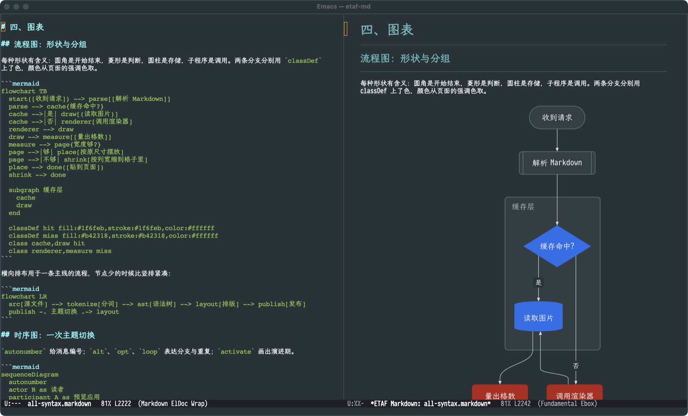
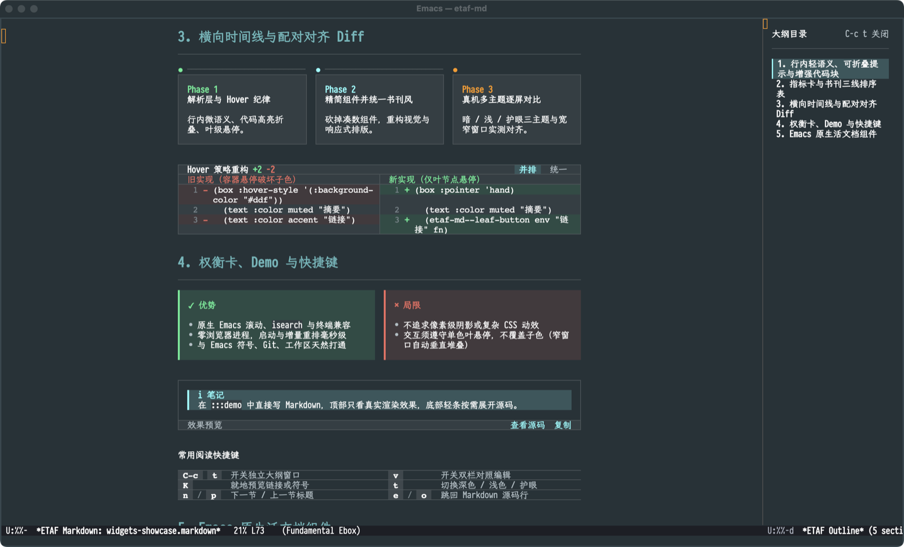
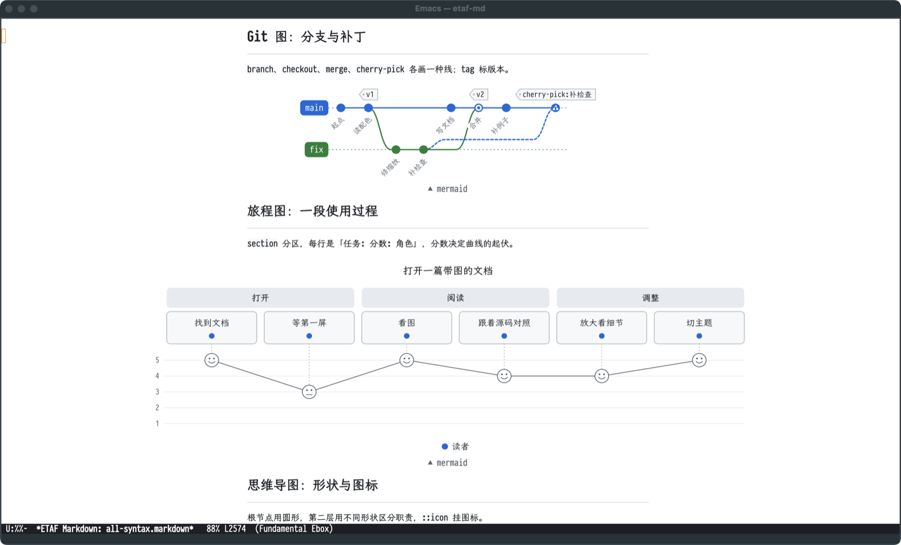

# ETAF Markdown Preview

[中文](README.zh-CN.md)

ETAF Markdown Preview renders a local Markdown document as a modern reading view inside Emacs. Built on [ETAF](https://github.com/emacs-taf/etaf) components and the [Ebox](https://github.com/emacs-taf/ebox) renderer, it combines a centered reading measure, typographic heading scale, syntax-highlighted code blocks with line markers and copy actions, full-grid pipe tables, GitHub alerts, footnotes, local image/video playback, native zero-browser Mermaid diagrams and MathJax display formulas, documentation containers, and Emacs living-document widgets — all inside one ordinary Emacs buffer so native scrolling, isearch and window splitting keep working.

Wide single-window reading view (`M-x etaf-md-open`) with headings, callouts, full-grid tables, highlighted code blocks, and crisp native Mermaid & MathJax SVGs:


Side-by-side live editing (`M-x etaf-md-preview` or `v`) with O(Δ) block-level repainting, proportional scroll-follow and jump-to-source:



Documentation containers (`:::name {attrs}`) and Emacs-native living-document widgets (`stats`, `timeline`, `tabs`, `diff`, `code-ref`, `symbol`, `git-log`):



Light, dark, sepia and face-derived `auto` palettes (`t` to cycle), keeping every table, container, Mermaid diagram and formula crisp across themes:



## Capabilities

- **Full Markdown + GFM + ETAF extensions**: CommonMark blocks and inlines, pipe tables with full grid borders and alignment, interactive task checkboxes (`- [x]` writing back to source), numbered footnotes with jump & `↩` back-link, YAML front matter, GitHub / Obsidian collapsible alerts (`> [!NOTE]`), `==highlights==`, `!!spoilers!!`, `[+annotations]`, `*[ABBR]:` cards, `[[wiki-links]]`, `:kbd[...]`, `:badge[...]`, `:color[...]`, `:sym[...]` and selectable dialects (`etaf`, `gfm`, `commonmark`, or feature plists).
- **Rich fenced code blocks**: `title=`, `:line-numbers[=N]`, `:collapsed-lines[=N]`, `{1,4-7}`, `/word/` and `[!code highlight|focus|++|--|warning|error|word:...]` markers, `:whitespace`, `:indent-guides` and one-click copy.
- **Native zero-browser Mermaid & MathJax**: with the optional embedded QuickJS dynamic module (`make native-build`, architecture inspired by [LuciusChen/pele.el](https://github.com/LuciusChen/pele.el)), `mermaid` fences render via vendored [Obsidian Pele](https://github.com/obsidianmd/pele) with native CoreText / Pango label measurement and `$$` display formulas render via vendored [MathJax](https://github.com/mathjax/MathJax-src) TeX-to-SVG inside a sandboxed background thread — zero Chromium, zero Node.js, crisp standalone SVGs cached on disk, stale-while-revalidate during live edits, and automatic fallback to [mermaid-cli](https://github.com/mermaid-js/mermaid-cli) + KaTeX for unsupported dialects or builds without the native module.
- **Extensible `:::` documentation containers & living docs**: over 35 built-in containers (`card`, `columns`, `box`, `steps`, `timeline`, `stats`, `field`, `file-tree`, `chat`, `tabs`, `code-tabs`, `accordion`, `details`, `table`, `window`, `panel`, `tab-panel`, `form`, `chart`, `progress`, `keymap`, `breadcrumb`, `diff`, `pros-cons`, `demo`, `qrcode`, `code-tree`, `npm-to`, `image-card`, `link-card`) plus sandboxed workspace living-document widgets (`include`, `code-ref`, `symbol`, `project-tree`, `git-log`, `git-diff`) and trust-gated Runbook `run` blocks. Add custom node types with `etaf-md-define-node`; see [the extension syntax](docs/extensions.md).
- **Incremental live editing & minimal command surface**: global `M-x` exposes strictly two commands — `M-x etaf-md-open` (full-width single-window reader, `q` restores the source buffer) and `M-x etaf-md-preview` (non-destructive right-split live preview with proportional scroll-follow). Edits coalesce onto a 16 ms frame tick and splice-repaint only the changed block slice while preserving every other block's interactive state.
- **Media, lightbox & navigation**: local images and async-cached remote HTTP(S) images (`etaf-md-remote-images`), in-buffer media lightbox (`RET` on images and Mermaid diagrams), inline video playback via ETAF's video Component (`ffmpeg`), independent `*ETAF Outline*` side window (`C-c t`), outline jumps (`n`/`p`, `C-c j`), reverse jump to source (`e`/`o`), link/symbol preview (`K`), spoiler toggle (`S`), theme cycle (`t`), measure bounds (`[`/`]`) and in-buffer searchable help (`?`).

## Prerequisites

| Requirement | Why | Check |
| --- | --- | --- |
| Emacs 29.1 or newer | the ETAF runtime and Ebox | `emacs --version` |
| ETAF (`>= 0.3.6`), ETAF UI (`>= 0.3.4`), Ebox and ECSS | rendering and the component catalog | installed automatically via `etaf-install` |
| C11 compiler + Python 3 (optional, recommended) | builds `native/etaf-md-typeset-native` (`make native-build`) for fast zero-browser Mermaid and math SVGs (macOS uses CoreText; Linux uses Pango when available) | `cc --version` |
| ffmpeg (optional) | inline video playback and terminal image conversion | `ffmpeg -version` |
| Node.js 18 + mermaid-cli (optional fallback) | fallback renderer when the native module is not built or for unsupported Mermaid dialects | `mmdc --version` |
| qrencode (optional) | renders `qrcode` blocks | `qrencode -V` |
| git (optional) | powers `git-log` and `git-diff` living-doc blocks | `git --version` |

## Installation

### From the ETAF package archive (recommended)

```elisp
(require 'package)
(add-to-list 'package-archives '("etaf" . "https://etaf.top/packages/"))
(package-initialize)
(package-refresh-contents)
(package-install 'etaf-install)
```

Then run `M-x etaf-install` and select `etaf-md` — the installer automatically fetches `etaf`, `etaf-ui`, `ebox` and `ecss`.

To enable the fast zero-browser QuickJS Mermaid & MathJax renderer (all upstream sources are bundled under `native/vendor/`, no network required), run `make native-build` once inside the installed `etaf-md` package directory:

```sh
cd ~/.emacs.d/elpa/etaf-md-* && make native-build
```

Run `M-x etaf-install-doctor` (or evaluate `(etaf-md-doctor)`) at any time to inspect whether `typeset-native`, `ffmpeg`, `mmdc`, `qrencode` and `git` are active.

### From a source checkout

Clone this repository next to the framework checkouts so the directories are siblings, optionally run `make native-build`, then add each repository root to `load-path`:

```elisp
(add-to-list 'load-path "/path/to/emacs-taf/ecss")
(add-to-list 'load-path "/path/to/emacs-taf/ebox")
(add-to-list 'load-path "/path/to/emacs-taf/etaf-ui")
(add-to-list 'load-path "/path/to/emacs-taf/etaf")
(add-to-list 'load-path "/path/to/emacs-taf/etaf-md")
(require 'etaf-md)
```

## Usage

Inside any Markdown buffer, run `M-x etaf-md-open` to read it full-width in the current window without prompting or splitting (`C-u M-x etaf-md-open` or running from another buffer prompts for a file; `q` restores the originating buffer in place). While authoring, run `M-x etaf-md-preview` in the source buffer to toggle a side-by-side right split with scroll-follow, or press `v` inside a preview to toggle the split on the fly.

```
M-x etaf-md-open         # read current .md file (or pick a file) in current window
M-x etaf-md-preview      # toggle side-by-side live preview beside source buffer
```

Try the bundled example pages right away: `examples/all-syntax.markdown` exercises every supported Markdown feature, container and diagram type in one page; `examples/widgets-showcase.markdown` demonstrates editorial containers and Emacs living-document widgets; `examples/sample.markdown` is a realistic long manual used as the performance workload.

| Key | Action |
| --- | --- |
| `n` / `p` | next / previous heading (pushes mark) |
| `C-c j` | jump to heading with completion |
| `C-c t` | toggle the independent `*ETAF Outline*` right side window |
| `e` / `o` | jump back to the matching line in the source buffer |
| `v` | toggle side-by-side source + live preview split |
| `f` | toggle proportional scroll-follow with the source window |
| `RET` or mouse-1 | activate link, toggle checkbox, open image/diagram lightbox, or play/pause video |
| `g` / `r` | re-read and repaint the document |
| `t` | cycle theme (`dark` / `light` / `sepia` / `auto`) |
| `[` / `]` | narrow / widen the reading measure |
| `K` / `S` | preview link or symbol at point / reveal or hide all spoilers |
| `?` / `C-c h` | searchable in-buffer help modal |
| `q` | close the preview (restore previous buffer, or close live split) |
| `C-s`, `C-v`, `M-v`, wheel | native isearch and scrolling |

## Development

```sh
make native-build     # build the embedded QuickJS + Pele + MathJax native module
make check            # structure, compilation, API bindings, acceptance tests
make benchmark        # batch render baseline for a generated large document
make mermaid-check    # draw every mermaid fixture in each page palette
```

## Acknowledgements

The embedded QuickJS + Pele + CoreText/Pango background-thread SVG renderer in `native/` is directly inspired by [LuciusChen/pele.el](https://github.com/LuciusChen/pele.el), building on unmodified vendored [Obsidian Pele](https://github.com/obsidianmd/pele), Fabrice Bellard's [QuickJS](https://github.com/bellard/quickjs) and [MathJax](https://github.com/mathjax/MathJax-src). See [native/vendor/README.md](native/vendor/README.md) for exact upstream versions, SHA-256 digests and retained licenses.

## Documentation

- User manual: [docs/manual.md](docs/manual.md) · [中文手册](docs/manual.zh-CN.md)
- Extension syntax & container catalogue: [docs/extensions.md](docs/extensions.md) · [扩展语法（中文）](docs/extensions.zh-CN.md)
- Architecture & performance envelope: [docs/architecture.md](docs/architecture.md)
- Public API inventory: Commentary of [etaf-md.el](etaf-md.el)
- Version history: [CHANGELOG.md](CHANGELOG.md)
