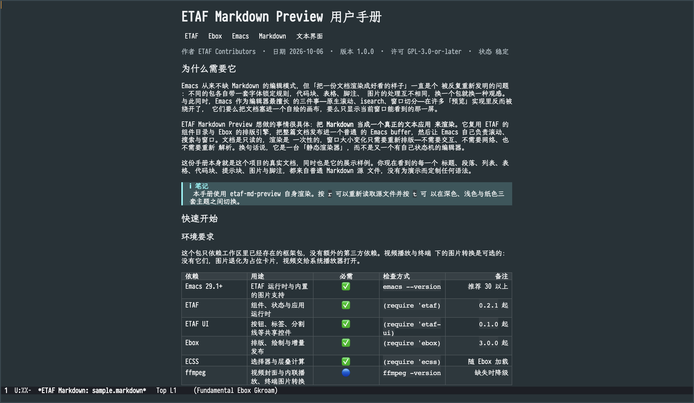

# ETAF Markdown Preview

ETAF Markdown Preview renders a local Markdown document as a modern reading
view inside Emacs. It draws the document with [ETAF](https://github.com/emacs-taf/etaf)
components and the [Ebox](https://github.com/emacs-taf/ebox) renderer: a
centered reading measure, a typographic heading scale, fenced code blocks with
language tags, blockquotes, nested lists, task markers, pipe tables, thematic
breaks, numbered footnotes, clickable links, and local image and video cards.
The whole document publishes into one ordinary Emacs buffer, so native
scrolling, isearch and window splitting keep working.

A document may also write **containers** — a `:::name {attrs}` block around
markdown — which turn it into a documentation page: callouts, cards, columns,
steps, a timeline, a file tree, tabs, a table with highlighted rows, a window
frame, a QR code.  The shipped vocabulary is
[specified in full](docs/extensions.md), and a reader may add a node type of
their own with `etaf-md-define-node`.



## Capabilities

- CommonMark blocks and inlines: ATX and Setext headings, paragraphs, emphasis
  and strong emphasis, strikethrough, inline code, links (inline, reference and
  shortcut), autolinks, images, fenced and indented code, blockquotes, nested
  ordered/unordered lists, thematic breaks and character references.
- GitHub extensions: pipe tables with alignment, task list items, bare URL
  autolinks and numbered footnotes.
- GitHub alerts (`> [!NOTE]` and friends) render as titled callout blocks.
- Containers: `:::name {attrs}` blocks with the shipped documentation
  vocabulary, `@tab` markers inside `tabs` and `code-tabs`, style rules that
  restyle a type, and a definition API for adding a type of your own.  See
  [the extension syntax](docs/extensions.md).
- Fenced code blocks take plume's options — `title=`, `:line-numbers[=N]`,
  `{1,4-7}` and `[!code ...]` row markers — and carry a copy action.
- A `qrcode` block draws its text as a scannable code through `qrencode`.
- With [mermaid-cli](https://github.com/mermaid-js/mermaid-cli) installed, a
  `mermaid` fence is drawn as a diagram and a `$$` display formula is typeset
  by KaTeX in the same Chromium.  Pictures render in the background and are
  cached by source and colours; without the program both keep their source,
  and an inline `$...$` formula always stays text.
- A `:flavor` argument selects `gfm` (default), `commonmark`, or a feature
  plist that toggles individual extensions.
- YAML front matter is stripped from the body and feeds the document title.
- Local images render through ETAF's image Host (graphics in a graphical
  frame, terminal conversion otherwise); a local video starts as a still
  poster, and RET (or a click) mounts ETAF's native video Component to play it
  in place, toggling play/pause on later presses.  Without ffmpeg the card
  keeps the poster and opens the video in the system player.
- Links open in the browser, jump to in-document headings, or open local files;
  a missing media file becomes a labeled card instead of an error.
- Three fixed palettes (dark, light and sepia) plus a face-derived default
  (`etaf-md-theme' = `auto') that follows the active Emacs theme and
  paints no page background; all colors are published as `:ui-*` theme tokens
  so shared ETAF UI components follow the preview.  A floating panel's
  title-bar switch writes the same theme cell, so it can pin `亮` / `暗` /
  `纸` or return to `随` and the document repaints with the panel.
- Outline navigation (`n`/`p`, `C-c j`), imenu integration, reloading (`r`), an
  adjustable maximum reading measure (`[`/`]`) and native scrolling. The
  measure keeps a two-cell gutter on each side, so even a window narrower than
  the measure starts its text off the edge. A window resize reflows through
  the framework's viewport update without rebuilding the view.
- A preview opened from a file follows that file: an edit in its buffer
  repaints the document on the next frame, block by block, so the block under
  the caret is the only one rendered again; saving it or changing it on disk
  from another program repaints it too. `r` still reloads from disk on demand.
  The page itself is read-only — the markdown is edited in its own buffer.
- `etaf-md-preview` splits the current window, opens the
  preview beside the source and leaves the point in the source, so one command
  from a Markdown buffer sets up editing with a live preview; `q` closes the
  preview and gives the window back.
- Four user options: `etaf-md-theme`, `etaf-md-flavor`,
  `etaf-md-width-min` and `etaf-md-width-max`.

## Prerequisites

| Requirement | Why | Check |
| --- | --- | --- |
| Emacs 29.1 or newer | the ETAF runtime and Ebox | `emacs --version` |
| ETAF, ETAF UI, Ebox and ECSS on `load-path` | rendering and the component catalog | see Installation |
| ffmpeg (optional) | video playback and terminal image conversion | `ffmpeg -version` |
| Node.js 18 or newer | runs the drawing script mermaid-cli provides | `node --version` |
| mermaid-cli (optional) | mermaid diagrams and typeset display formulas | `mmdc --version` |
| qrencode (optional) | a `qrcode` block | `qrencode -V` |
| Chrome, Chromium or Edge (optional) | the browser mermaid-cli draws with | `ETAF_MD_CHROME` or a default install path |

Diagrams and formulas need Node plus mermaid-cli.  mermaid-cli launches a
browser itself, and a machine that already has Chrome does not need to download
a second Chromium: the drawing script uses `ETAF_MD_CHROME` when it is set, then
the default install paths of Chrome on Windows and macOS, then a Chromium
mermaid-cli brought itself.  Without these the page keeps a diagram's source and
falls back to Unicode for a formula, which is what the preview shows on a
machine that has only Emacs.

Install the drawing tools with the package manager already on such a machine:

```sh
npm install -g @mermaid-js/mermaid-cli
```


## Installation

Clone this repository next to the framework checkouts so the directories are
siblings, then add each repository root to `load-path` and require the entry:

```elisp
(add-to-list 'load-path "/path/to/emacs-taf/ecss")
(add-to-list 'load-path "/path/to/emacs-taf/ebox")
(add-to-list 'load-path "/path/to/emacs-taf/etaf-ui")
(add-to-list 'load-path "/path/to/emacs-taf/etaf")
(add-to-list 'load-path "/path/to/emacs-taf/etaf-md")
(require 'etaf-md)
```

`M-x etaf-md-open` then prompts for a file. A package installation that
exposes the root entry through package.el does not need the manual
`add-to-list` for this repository.

## Usage

```
M-x etaf-md-open RET README.md RET
```

`examples/all-syntax.markdown` is the one page that writes every supported
syntax once, with its rendering next to it: prose, containers, the site
components, code-block options and every diagram kind.  It doubles as the
syntax inventory and as the page to open when checking a change.
`examples/sample.markdown` is a realistic long document written for the
previewer and used as the performance workload.

| Key | Action |
| --- | --- |
| `n` / `p` | next / previous heading |
| `C-c j` | choose a heading |
| `RET` or mouse-1 | activate the link or image under point; play or pause a video |
| `r` | re-read and repaint the document |
| `t` | cycle dark / light / sepia |
| `[` / `]` | narrow / widen the reading measure |
| `?` / `C-c h` | searchable help inside the preview |
| `q` | close the preview |
| `C-s`, `C-v`, wheel | native isearch and scrolling |

`M-x etaf-md-follow-scroll` makes the page move with the source
window: the block at the top of the markdown buffer becomes the first row of
the preview as the source scrolls, so a reader keeping the two side by side
sees the same place in each.  Only the source's scrolling follows; scrolling
the preview itself stays free.

Help follows the preview's theme without splitting its window. `/` searches
the effective bindings; Escape leaves search editing before closing help.
Clicking the dimmed background also closes it and restores the previous focus.

## Development

```sh
make check            # structure, compilation, API bindings, acceptance
make benchmark        # batch render baseline for a generated large document
make mermaid-check    # draw every mermaid fixture in each page palette
```

See [docs/manual.md](docs/manual.md) for workflows, the supported syntax and
scripting, [docs/extensions.md](docs/extensions.md) for the container
vocabulary and the definition API (Chinese version in
[docs/extensions.zh-CN.md](docs/extensions.zh-CN.md)), and
[docs/architecture.md](docs/architecture.md) for the module layout and the
rendering decisions.
