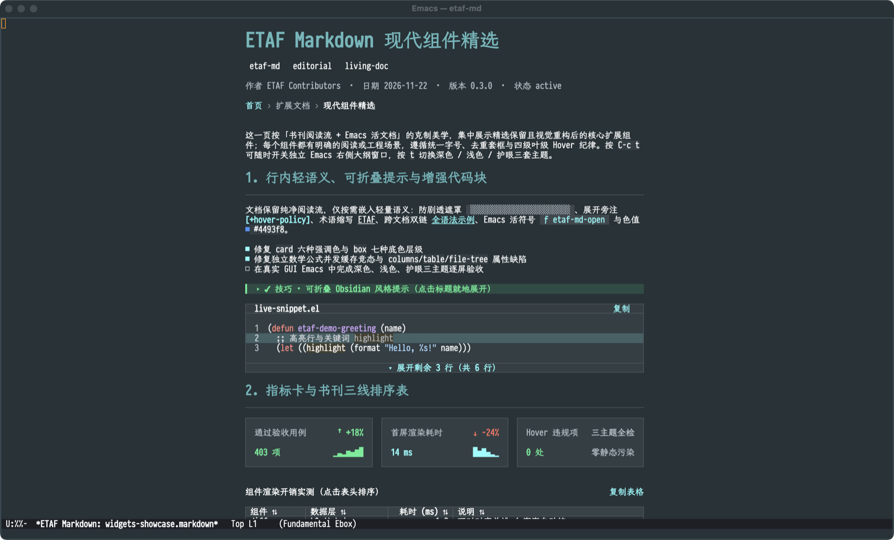
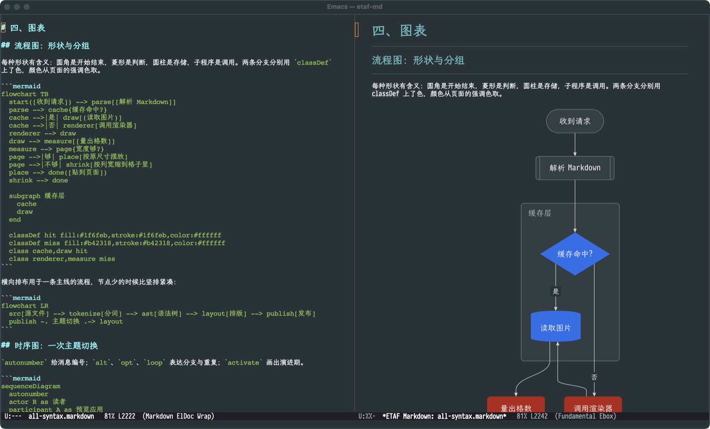
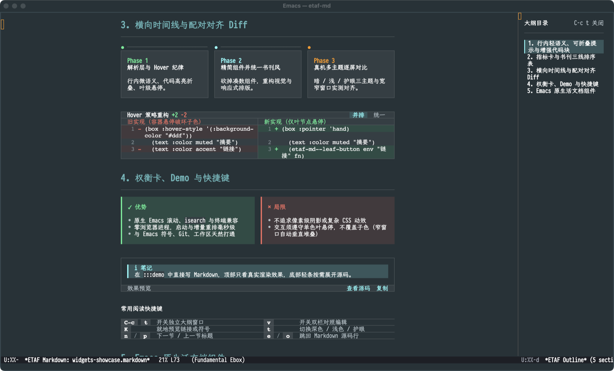

# ETAF Markdown 预览器（etaf-md）

[English](README.md)

ETAF Markdown Preview 把本地 Markdown 文档渲染为 Emacs 原生的现代阅读视图。它基于 [ETAF](https://github.com/emacs-taf/etaf) 组件体系与 [Ebox](https://github.com/emacs-taf/ebox) 排版引擎，在普通 Emacs buffer 中提供居中阅读版心、标题层级缩放、带行高亮与复制按钮的代码块、完整网格线的管道表格、GitHub 提示块、脚注、本地图片与视频就地播放、零浏览器原生 Mermaid 图表与 MathJax 数学公式、文档容器以及 Emacs 活文档组件——同时完整保留 Emacs 原生滚动、`isearch` 与自由分窗体验。

单窗全宽阅读视图（`M-x etaf-md-open`），呈现标题层级、提示块、完整网格表格、高亮代码块以及原生渲染的 Mermaid 图表与 MathJax 公式：



双栏实时对照编辑（`M-x etaf-md-preview` 或预览内按 `v`），支持 O(Δ) 块级增量重绘、按比例同步滚动跟随与源码反向定位：



丰富的 `:::name {attrs}` 文档容器与 Emacs 原生活文档组件（`stats`、`timeline`、`tabs`、`diff`、`code-ref`、`symbol`、`git-log` 等）：



支持 `dark`、`light`、`sepia` 三套独立配色及跟随 Emacs 主题的 `auto` 模式（按 `t` 轮换），表格、容器、图表与公式在各套配色下均清晰可读：


## 核心能力

- **完整 Markdown + GFM + ETAF 扩展语法**：覆盖 CommonMark 块与行内语法、带完整行列网格线与对齐的管道表格、可交互回写源文件的任务复选框（`- [x]`）、带跳转与 `↩` 回跳的编号脚注、YAML front matter、GitHub / Obsidian 可折叠提示块（`> [!NOTE]`）、`==高亮==`、`!!遮罩!!`、`[+批注]`、`*[ABBR]:` 术语卡片、`[[双向链接]]`、`:kbd[...]`、`:badge[...]`、`:color[...]`、`:sym[...]`，并支持通过 `:flavor` 选择 `etaf`、`gfm`、`commonmark` 或细粒度特性列表。
- **增强代码块**：支持 `title=`、`:line-numbers[=N]`、`:collapsed-lines[=N]`、`{1,4-7}`、`/word/` 与 `[!code highlight|focus|++|--|warning|error|word:...]` 行标记、`:whitespace`、`:indent-guides` 以及一键复制。
- **零浏览器原生 Mermaid 与 MathJax 渲染**：通过 `M-x etaf-install-native` 一键下载校验预编译 QuickJS 原生动态模块（架构借鉴 [LuciusChen/pele.el](https://github.com/LuciusChen/pele.el)，全程无需本机编译器）后，`mermaid` 代码块经由内嵌 [Obsidian Pele](https://github.com/obsidianmd/pele) + CoreText / Pango 原生文本测量直接渲染为清晰矢量 SVG，`$$` 块级公式经由内嵌 [MathJax](https://github.com/mathjax/MathJax-src) TeX-to-SVG 在独立后台线程中渲染——无需 Chromium、无需 Node.js、零子进程开销，结果落盘缓存；实时编辑期间保留上一帧有效图片不闪烁，未安装原生模块或遇到 Pele 未实现的图种时自动回退至 [mermaid-cli](https://github.com/mermaid-js/mermaid-cli) + KaTeX。
- **可扩展 `:::` 文档容器与活文档工作台**：内置 35+ 种文档构件（`card`、`columns`、`box`、`steps`、`timeline`、`stats`、`field`、`file-tree`、`chat`、`tabs`、`code-tabs`、`accordion`、`details`、`table`、`window`、`panel`、`tab-panel`、`form`、`chart`、`progress`、`keymap`、`breadcrumb`、`diff`、`pros-cons`、`demo`、`qrcode`、`code-tree`、`npm-to`、`image-card`、`link-card`），以及受工作区沙箱保护的 Emacs 活文档组件（`include`、`code-ref`、`symbol`、`project-tree`、`git-log`、`git-diff`）和受信任门禁控制的 `run` 运行块。支持用 `etaf-md-define-node` 自定义节点类型，详见[扩展语法](docs/extensions.zh-CN.md)。
- **增量实时编辑与极简全局命令面**：全局 `M-x` 仅暴露两个入口命令——`M-x etaf-md-open`（单窗全宽阅读，按 `q` 原地切回源码）与 `M-x etaf-md-preview`（源码右侧非破坏性实时对照分屏，自带滚动跟随）。编辑改动按 16 ms 帧节拍合并，仅对受影响的块切片增量解析与重绘，其余块的组件实例与交互状态完好保留。
- **媒体播放、页内灯箱与大纲导航**：本地图片与异步缓存的远程 HTTP(S) 图片（`etaf-md-remote-images`）、按 `RET` 开启页内灯箱看图（同时支持图片与 Mermaid 图表）、内嵌视频组件就地播放（`ffmpeg`）、右侧独立 `*ETAF Outline*` 大纲窗（`C-c t`）、标题跳转（`n`/`p`、`C-c j`）、跳回源码（`e`/`o`）、链接与符号浮卡预览（`K`）、全局遮罩显隐（`S`）、配色轮换（`t`）、版心宽度调节（`[`/`]`）与页内可搜索帮助面板（`?`）。

## 运行环境

| 依赖 | 用途 | 检查方式 |
| --- | --- | --- |
| Emacs 29.1 或更新版本 | 运行 ETAF 与 Ebox | `emacs --version` |
| ETAF（`>= 0.3.6`）、ETAF UI（`>= 0.3.4`）、Ebox 与 ECSS | 渲染与共享组件目录 | 通过 `etaf-install` 自动安装 |
| 预编译原生模块（可选，推荐） | 无需本地编译器，通过 `M-x etaf-install-native` 一键下载并校验至 `~/.cache/emacs-taf/native/`，启用零浏览器高速 Mermaid 与公式渲染 | `M-x etaf-install-doctor` |
| ffmpeg（可选） | 视频就地播放与终端图片转换 | `ffmpeg -version` |
| Node.js 18 + mermaid-cli（可选兜底） | 未编译原生模块或遇到未支持 Mermaid 图种时的自动回退后端 | `mmdc --version` |
| qrencode（可选） | 渲染 `qrcode` 二维码块 | `qrencode -V` |
| git（可选） | 驱动 `git-log` 与 `git-diff` 活文档组件 | `git --version` |

## 安装

### 通过 ETAF 包归档安装（推荐）

```elisp
(require 'package)
(add-to-list 'package-archives '("etaf" . "https://etaf.top/packages/"))
(package-initialize)
(package-refresh-contents)
(package-install 'etaf-install)
```

随后运行 `M-x etaf-install` 并选择 `etaf-md`：安装器会一步完成 `etaf`、`etaf-ui`、`ebox`、`ecss` 依赖安装，并自动下载对应平台的预编译 QuickJS Mermaid 与 MathJax 原生渲染模块、校验 SHA-256 后缓存至 `~/.cache/emacs-taf/native/`（升级 `etaf-md` 不丢失，无需本机 C 编译器、Node.js 或 `make`）并立即热加载生效，装完直接可用。

如果此前在离线环境或通过 `package-install` 直接安装了 `etaf-md`，随时可运行 `M-x etaf-install-native`（或在 `M-x etaf-install-manage` 选中 `etaf-md` 按 `n`）补装或刷新预编译二进制；运行 `M-x etaf-install-doctor`（或求值 `(etaf-md-doctor)`）可查看 `typeset-native`、`ffmpeg`、`mmdc`、`qrencode` 与 `git` 的就绪状态。

### 从源码检出使用

将本仓库与框架仓库克隆为同级目录，按需执行 `make native-build`，再将各仓库根目录加入 `load-path`：

```elisp
(add-to-list 'load-path "/path/to/emacs-taf/ecss")
(add-to-list 'load-path "/path/to/emacs-taf/ebox")
(add-to-list 'load-path "/path/to/emacs-taf/etaf-ui")
(add-to-list 'load-path "/path/to/emacs-taf/etaf")
(add-to-list 'load-path "/path/to/emacs-taf/etaf-md")
(require 'etaf-md)
```

## 使用方式

在任意 Markdown 缓冲区内运行 `M-x etaf-md-open`，直接在当前窗口全宽打开阅读视图（免弹窗、不分屏；加 `C-u` 或在其他缓冲区运行则提示选择文件；按 `q` 原地切回原缓冲区）。边写边看时，在源码缓冲区运行 `M-x etaf-md-preview` 即可在右侧非破坏性地开启双栏实时对照预览（自带按比例滚动跟随），在预览内按 `v` 也可随时切换单窗与双栏。

```
M-x etaf-md-open         # 在当前窗口全宽阅读当前 .md 文件（或选择文件）
M-x etaf-md-preview      # 在源码右侧开关双栏实时对照预览
```

安装完成后直接对任意本地 `.md` 文件运行 `M-x etaf-md-open` 或 `M-x etaf-md-preview` 即可体验（ELPA 归档包刻意省略了开发用的 `Makefile` 与 `examples/` 以保持精简；源码检出仓库中保留了 `examples/all-syntax.markdown`、`examples/widgets-showcase.markdown` 与 `examples/sample.markdown` 供开发与性能回归使用）。

| 按键 | 作用 |
| --- | --- |
| `n` / `p` | 跳到下一个 / 上一个标题（跳转前压栈 mark） |
| `C-c j` | 补全选择标题跳转 |
| `C-c t` | 开关右侧独立 `*ETAF Outline*` 大纲窗 |
| `e` / `o` | 从预览当前位置反向跳回源文档对应行 |
| `v` | 在单窗全宽阅读与「左源码 + 右预览」双栏对照间切换 |
| `f` | 开关与源窗口按比例同步的滚动跟随 |
| `RET` 或鼠标左键 | 打开链接、切换任务复选框、在页内灯箱查看大图/图表，或就地播放/暂停视频 |
| `g` / `r` | 重新读取文件并重绘 |
| `t` | 轮换配色（`dark` / `light` / `sepia` / `auto`） |
| `[` / `]` | 收窄 / 加宽最大阅读宽度 |
| `K` / `S` | 就地预览光标处链接或 Emacs 符号 / 全局显隐遮罩 |
| `?` / `C-c h` | 在页内打开可搜索的帮助面板 |
| `q` | 关闭预览（单窗切回原缓冲区；分屏仅回收预览窗格） |
| `C-s`、`C-v`、`M-v`、滚轮 | Emacs 原生增量搜索与平滑滚动 |

## 开发与校验

```sh
make native-build     # 编译内置 QuickJS + Pele + MathJax 原生动态模块
make check            # 结构校验、字节编译、公开 API 校验与全量验收测试
make benchmark        # 大文档解析与渲染基线
make mermaid-check    # 在各套配色下全量校验 Mermaid 样例
```

## 致谢

`native/` 目录下的内置 QuickJS + Pele + CoreText/Pango 后台线程 SVG 渲染架构直接借鉴了 [LuciusChen/pele.el](https://github.com/LuciusChen/pele.el)，并基于未经修改的内嵌上游项目 [Obsidian Pele](https://github.com/obsidianmd/pele)、Fabrice Bellard 的 [QuickJS](https://github.com/bellard/quickjs) 与 [MathJax](https://github.com/mathjax/MathJax-src) 构建。精确的上游版本号、SHA-256 校验值与完整许可证详见 [native/vendor/README.md](native/vendor/README.md)。

## 文档导航

- 用户手册：[中文手册](docs/manual.zh-CN.md) · [English Manual](docs/manual.md)
- 扩展语法与容器目录：[扩展语法（中文）](docs/extensions.zh-CN.md) · [Extension Syntax](docs/extensions.md)
- 架构与性能说明：[docs/architecture.md](docs/architecture.md)
- 公开 API 清单：[etaf-md.el](etaf-md.el) 头部 Commentary
- 更新日志：[CHANGELOG.md](CHANGELOG.md)
