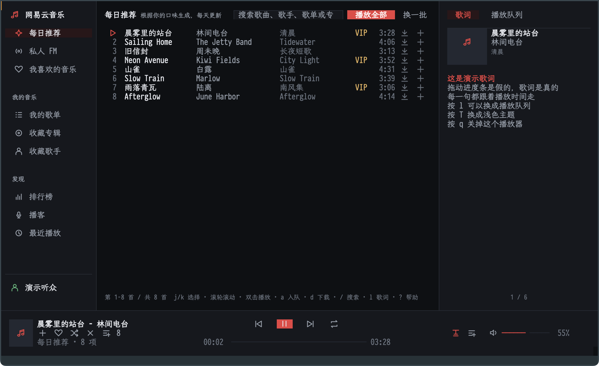
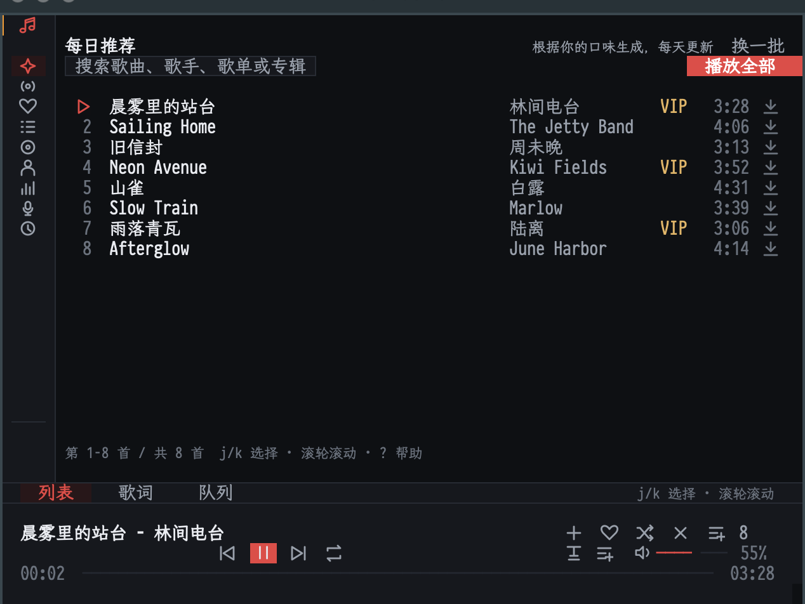
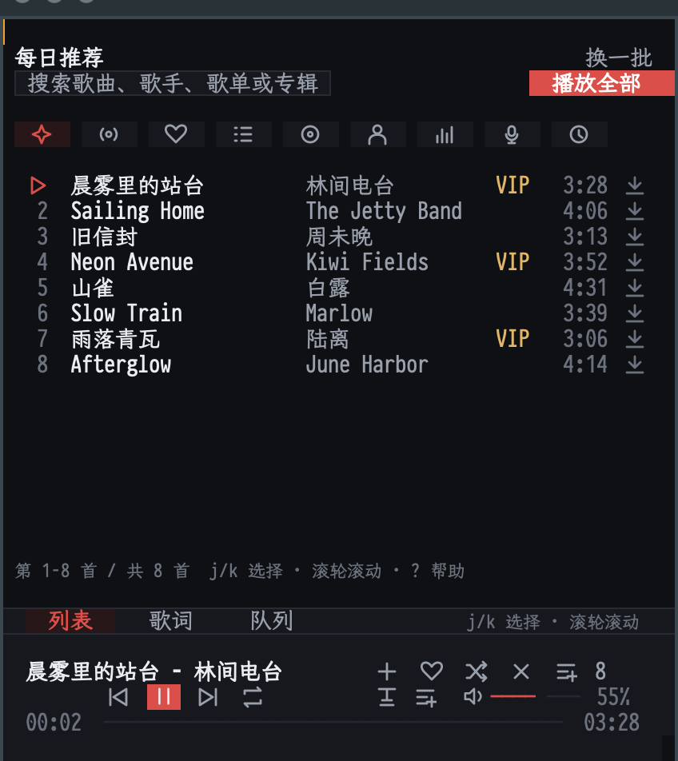
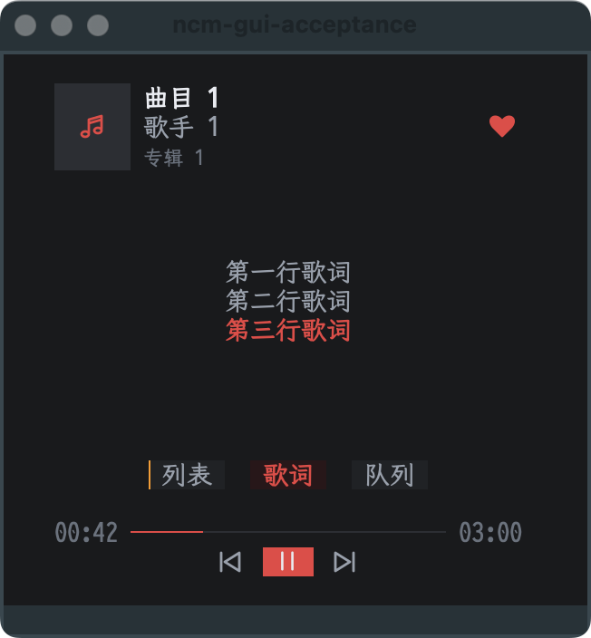
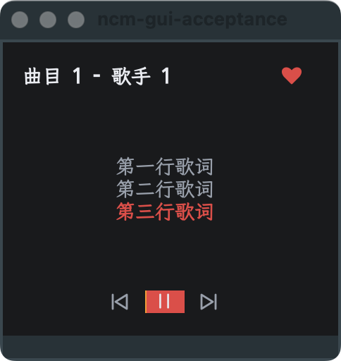
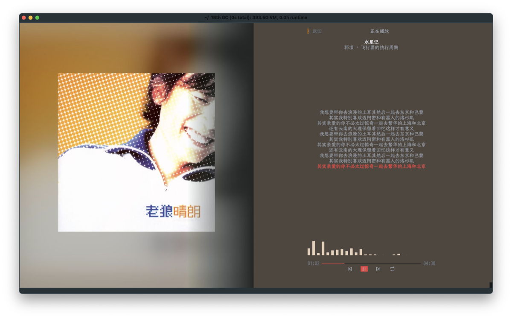
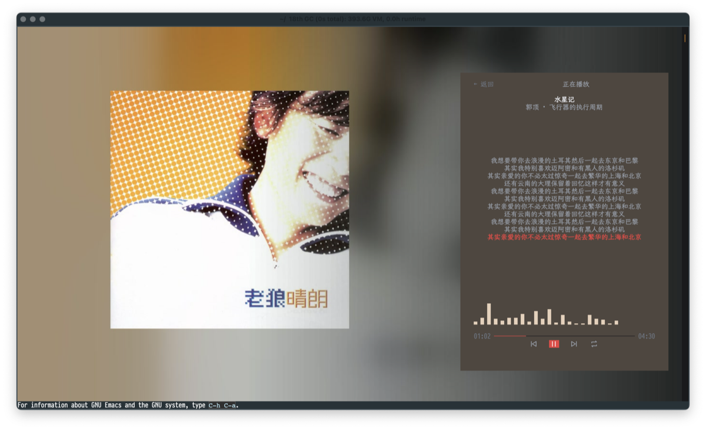

# ETAF NCM

ETAF NCM is a NetEase Cloud Music client for Emacs. It renders the signed-in
account's music library, playback and lyric as one ETAF view: a sidebar of
libraries, a paginated song list, a panel with the synchronized lyric or the
queue, and a playback bar. mpv keeps playing; the player is the interface over
the `netease-music` backend.

The player at a wide frame:



At a medium frame the sidebar becomes an icon rail and the side pane turns
into tabs:



At a narrow frame the libraries become a chip strip and the panes stack under
tabs:



A frame too small for that chrome becomes a card: the cover, the track, one
pane, its switch and the transport, with one clear row between the bands.



At the smallest size the card becomes a tile that keeps only the track, the
lyric and the transport:



`o` opens the playing page: the whole cover as one picture with a sharp copy
over it, and the track, the centred lyric, the spectrum and the transport.  A
wide window splits it in half; `m` cycles the designs:



`m` switches to the poster: the picture across the whole page with the text on
a block floating over it.



## Capabilities

- Libraries: daily recommendation, private FM, liked songs, playlists, saved
  albums and artists, charts, podcasts, recent plays.
- Search by song, with a playlist scope; results behave like any library.
- Playback: play a row or a whole list, pause, skip, stop, volume, relative
  seek, shuffle, repeat, like and unlike.
- Local library: inline download and queue icons act directly, without menus.
  The `d` key downloads the selection; a check marks local songs. The next queue plays the
  local file instead of fetching a fresh stream URL.
- Queue: a window that follows the playing song, wheel through every loaded
  entry, jump to any of them, append songs.
- Lyric: LRC parsed into timed lines, current line highlighted, translation
  shown next to it when the backend has one.
- Two palettes (dark and light) with one key, published as `:ui-*` theme tokens
  so the shared ETAF UI controls follow the same colours.
- A playing page for the whole window (`o`).  A wide window splits it in half —
  the picture on one side, the track, the centred lyric, the spectrum and the
  transport on the other; a narrow or short one turns it into a poster with the
  controls under it.  `m` cycles the designs.  It opens from every layout,
  including the card and tile where no cover is drawn.
- Headless sessions for scripts and tests: no buffer, no timer and a scripted
  client are all supported.
- Window layouts: three columns on a wide frame, a glyph-only rail with one pane
  on a medium one, a phone-like stacked layout on a narrow one, and a card or
  tile that keeps only the playing essentials when the frame is too small for
  that chrome.

## Prerequisites

| Requirement | Why | Check |
| --- | --- | --- |
| Emacs 29.1 or newer | the ETAF runtime | `emacs --version` |
| Node.js 22 or newer | runs the backend's API client | `command -v node` |
| Python 3 | the backend's queue, download and mpv helpers | `command -v python3` |
| mpv | plays the audio | `command -v mpv` |
| `etaf`, `etaf-ui`, `ebox`, `ecss` | the framework; each repository's root entry must be on `load-path` | every checkout is readable |
| Bundled backend | library, playback, lyric and login | ships inside this package; its scripts are readable |

The player is the interface only: the backend owns the account, the queue file
and mpv.  Install the tools, sign in once, then open the player.

## Installation

### 1. System tools

```sh
brew install node python3 mpv    # macOS; Debian: apt install nodejs python3 mpv
```

`qrencode` is optional and only used when you sign in by scanning a QR code;
the SMS login needs nothing extra.

### 2. The bundled backend and its one-time login

The account, queue and playback backend ships inside this package under
`backends/netease/`; nothing else has to be installed or cloned.  Check the
tools and the login:

```sh
BACKEND="$(dirname "$(locate-library etaf-ncm)")/backends/netease"
bash "$BACKEND/scripts/netease-music.sh" check     # dependencies + login state
```

Log in once; the cookie stays local to this machine:

```sh
bash "$BACKEND/scripts/netease-music.sh" login --sms <phone>   # sends a code, then
bash "$BACKEND/scripts/netease-music.sh" login --sms <phone> --sms-code <code>
# or scan a QR code with the NetEase Cloud Music app:
bash "$BACKEND/scripts/netease-music.sh" login
```

The player itself signs in through `scripts/netease-cli.mjs`, which is plain
Node and needs no shell, so the same sign-in works on Windows:

```sh
node "$BACKEND/scripts/netease-cli.mjs" login --sms <phone> --sms-code <code>
```

That Node entry is also what plays: `play`, the transport keys, volume, seek,
queue and cover are all its commands, and it drives mpv through a Unix socket
on macOS and Linux and a named pipe on Windows.  The shell entry stays as the
POSIX command line (downloads, queue snapshots, `check`, `watch`).

NetEase sometimes answers a code it accepted with `8860`
「请确认是否本人账号」: that is the account-confirmation step, not a wrong code.
The command then shows a QR code, and scanning it with the same account's app
finishes the sign-in.

The login, queue and saved queues live in the backend's state directory,
`${XDG_STATE_HOME:-~/.local/state}/netease-music`.  The player passes
`etaf-ncm-state-directory` to the backend, so both always read the same files.

### 3. The Emacs package

```elisp
(add-to-list 'load-path "/path/to/etaf")
(add-to-list 'load-path "/path/to/etaf-ui")
(add-to-list 'load-path "/path/to/ebox")
(add-to-list 'load-path "/path/to/ecss")
(add-to-list 'load-path "/path/to/etaf-ncm")
(require 'etaf-ncm)

(global-set-key (kbd "C-c m") #'etaf-ncm-open)
```

To try a modified backend copy, or to keep the state somewhere else, point the
app at it:

```elisp
(setq etaf-ncm-backend-directory "/path/to/netease"
      etaf-ncm-state-directory "~/.local/state/netease-music")
```

`M-x etaf-ncm-open` mounts the player in the selected window; `q` / `M-x
etaf-ncm-close` closes the window and keeps the backend playing, while `Q` /
`M-x etaf-ncm-quit` stops the backend player and closes.  Exiting Emacs stops
a player the app started.  `etaf-ncm-theme-mode` (`dark` or `light`) selects
the palette, and `etaf-ncm-refresh` (or `g` in the player) reloads the
library, playback truth, queue and account. `?` opens searchable keyboard
help in the player buffer without splitting the window or changing playback.
Escape leaves search editing, then closes help; a click on the backdrop also
closes it and restores focus. Use `M-x etaf-palette` to execute commands by name.

### Quick start for an agent

A non-interactive path to a working player (the login itself needs the user's
phone or QR scan once):

```sh
command -v node python3 mpv || brew install node python3 mpv
BACKEND="$(dirname "$(locate-library etaf-ncm)")/backends/netease"
test -x "$BACKEND/scripts/netease-music.sh" || {
  echo "netease-music backend not found: reinstall etaf-ncm" >&2; exit 1; }
bash "$BACKEND/scripts/netease-music.sh" check || bash "$BACKEND/scripts/netease-music.sh" login
```

```elisp
;; After adding the five repositories to `load-path':
(require 'etaf-ncm)
(etaf-ncm-open)                  ; real backend; returns the player buffer
```

A missing script, mpv or login leaves the player mounted with the backend
error in its message line; `g` retries after the backend is fixed.

## Minimal example

```elisp
(require 'etaf-ncm)

(let* ((player (etaf-ncm-create))          ; headless session
       (client (etaf-ncm-make-client)))
  (plist-put player :client client)
  (etaf-ncm-refresh player)                ; library, status, queue, account
  (while (plist-get (etaf-ncm-state player) :loading)
    (sit-for 0.05))
  (etaf-ncm-move-selection player 4)
  (etaf-ncm-activate-selection player)     ; plays the fifth row
  (plist-get (etaf-ncm-state player) :status))
```

## Runnable demo

`M-x etaf-ncm-demo-open` mounts the complete player on a scripted library, so it
needs no network, login or mpv. `M-x etaf-ncm-demo-live` opens the same player
against the installed backend. From a checkout with sibling providers:

```sh
cd etaf-ncm
emacs -Q -L ../ecss -L ../ebox -L ../etaf -L ../etaf-ui \
  -L . -l examples/etaf-ncm-demo.el -f etaf-ncm-demo-open
```

## Documentation

- [The manual](docs/manual.md): keys, libraries, playback, lyric, theming,
  scripting, custom backends and troubleshooting.
- [Architecture](docs/architecture.md): module responsibilities, data flow and
  invariants.
- [The root entry Commentary](etaf-ncm.el): the authoritative list of supported
  functions, variables, the app Component and the error type.

## Checks

`make check` runs the structure checker, byte compilation with warnings as
errors, the acceptance suite and the API boundary checker. The acceptance
scenarios drive a scripted backend, so they need no network, mpv or frame:

```sh
make compile   # byte compilation, warnings are errors
make test      # the public acceptance scenarios
make check     # structure + compile + acceptance + API boundary
```
