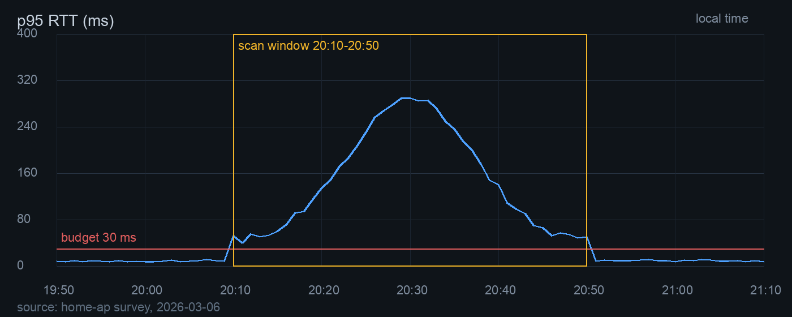

#+TITLE: ETAF Org 全语法与活文档总览
#+SUBTITLE: 原生 Org 语法全集 × 书刊阅读美学 × Org 工作区活文档
#+AUTHOR: ETAF Contributors
#+DATE: 2026-11-23
#+KEYWORDS: Org-mode, ETAF, 活文档, 书刊排版
#+FILETAGS: :etaf:org:gallery:
#+TODO: TODO NEXT WAIT | DONE CANCELLED
#+TODO: BUG FIXING | FIXED WONTFIX
#+OPTIONS: toc:nil num:nil ^:{}
#+MACRO: version 0.4.0
#+LINK: gh https://github.com/%s
#+ABBR: ETAF Emacs Text Application Framework
#+BIBLIOGRAPHY: references.bib

这是一份覆盖 =etaf-org= {{{version}}} *原生 Org 语法* 与 *书刊活文档组件* 的分类总览文档。阅读时可按 [[kbd:v]] 切换单窗全宽与左右对照分屏，按 [[kbd:T]] 开关页内可拖拽调宽的目录侧栏，按 [[kbd:t]] 切换深色 / 浅色 / 护眼 / 跟随主题，按 [[kbd:e]] 或 [[kbd:o]] 跳回对应 Org 源码行。

* 一、原生 Org 标题、任务、计划与抽屉 :native:
:PROPERTIES:
:CUSTOM_ID: native-headlines
:ID: gallery-native-headlines
:OWNER: ETAF Team
:END:

本节展示标题阶梯、多序列 TODO、优先级、继承标签、统计饼干、计划行、属性抽屉、工时日志与自定义抽屉。

** 二级标题（H2 · 1.50x + 底线）
*** 三级标题（H3 · 1.25x）
**** 四级标题（H4 · 1.10x）
***** 五级标题（H5 · 1.00x 静音墨色，永不缩小正文字号）

** TODO [#A] 高优未逾期任务 [2/3] :backend:urgent:
SCHEDULED: <2026-11-23 Mon 09:00-10:30> DEADLINE: <2026-12-05 Sat>
:PROPERTIES:
:CUSTOM_ID: task-high
:EFFORT: 2:00
:END:
:LOGBOOK:
CLOCK: [2026-11-21 Sat 14:00]--[2026-11-21 Sat 15:30] =>  1:30
- State "TODO"       from "NEXT"       [2026-11-21 Sat 15:30]
:END:

点击下方复选框可直接写回源码并同步上方 =[2/3]= 统计饼干：

- [X] 解析全部原生 Org 块与行内元素
- [X] 补齐多序列 =#+TODO:= 与真实逾期判定
- [ ] 在多主题与窄窗下检查完整展厅渲染效果

:NOTES:
这是一个自定义未知抽屉（=:NOTES:=）。默认收起为一个可点击芯片，点击该芯片即可局部展开，或按 =H= 全局切换显隐。
:END:

** NEXT [#B] 正在推进的逾期示例任务 :frontend:
DEADLINE: <2026-11-10 Tue>
:LOGBOOK:
CLOCK: [2026-11-22 Sun 10:00]--[2026-11-22 Sun 11:15] =>  1:15
:END:

当截止日期早于当前日期且任务未完成时，计划行会自动以危险色标出「（已逾期）」。

** BUG [#A] 多序列自定义关键词示例 :qa:
DEADLINE: <2026-11-24 Tue>

此条使用文档头第二条 =#+TODO: BUG FIXING | FIXED WONTFIX= 定义的 =BUG= 状态。

** DONE [#C] 已完成任务（过期不计入逾期） :release:
CLOSED: [2026-11-18 Wed 18:00] DEADLINE: <2026-11-15 Sun>
:LOGBOOK:
CLOCK: [2026-11-18 Wed 16:00]--[2026-11-18 Wed 17:45] =>  1:45
:END:

已完成状态带有 =CLOSED:= 时间戳，不会触发逾期告警。

** FIXED 多序列完成态示例 :qa:

来自第二条 =#+TODO:= 序列的完成态 =FIXED=。

** COMMENT 注释标题节（默认折叠且不入目录）

此节正文默认隐藏，按 =z= 可单独展开查看。

** 已归档历史记录 :ARCHIVE:

带有 =:ARCHIVE:= 标签的章节同样默认保持折叠。

* 二、原生 Org 行内格式、链接、实体、公式与脚注 :inline:
:PROPERTIES:
:CUSTOM_ID: native-inline
:END:

** 行内强调、代码、实体与上下标

支持 *粗体*、/斜体/、_下划线_、+删除线+、~行内代码~、=逐字文本=，以及嵌套组合 */粗斜体/*。

命名实体：\alpha + \beta \rightarrow \gamma，且 x \le y \approx \infty，版权 \copy，长破折号 \mdash。

受 =#+OPTIONS: ^:{}= 保护：=foo_bar= 与 =snake_case_name= 保持原样，而带花括号的 H_{2}O、CO_{2}、x^{2} + y^{n} 转为 Unicode 上下标。

** 货币消歧、行内公式、宏、行内源码与导出片段

严格 Org 公式边界：预算在 $100 到 $200 之间绝不会被误判为数学公式；真正的行内公式 $E = mc^2$ 与 \(\sum_{i=1}^{n} i = \frac{n(n+1)}{2}\) 正常解析。

宏展开结果：当前版本为 {{{version}}}；行内源码：src_elisp{(+ 1 2 3)}；导出片段（仅安全显示载荷，不求值）：@@html:HTML@@。

** 链接、锚点目标、时间戳与学术引用

- 外部链接与缩写链接：[[https://orgmode.org][Org Mode 官网]]、[[gh:emacs-taf/etaf-org][GitHub 仓库（#+LINK 缩写）]]
- 文档内跳转：[[*一、原生 Org 标题、任务、计划与抽屉][按标题跳回第一节]]、[[#native-blocks][按 CUSTOM_ID 跳到第三节]]、[[file:widgets-showcase.org][打开同目录 widgets-showcase.org]]
- 目标与无线电目标：定义 <<<无线电锚点>>>，并在正文引用 <<无线电锚点>>
- 时间戳形态：活跃 <2026-11-23 Mon 14:30>、非活跃 [2026-11-23 Mon]、时间段 <2026-11-23 Mon 09:00-11:30>、日期范围 <2026-11-23 Mon>--<2026-11-26 Thu>、重复与提前提醒 <2026-11-23 Mon +1w -2d>
- 学术引用（点击或按 =K= 可速览本地 BibTeX 元数据）：[cite:@knuth84; @lamport94] 与 [cite:@dominik2010]
- 脚注引用（点击跳至文末，点 =↩ 返回正文= 回到此处）：多段落脚注[fn:multi] 与内联匿名脚注[fn::这是一个直接写在正文里的内联脚注定义。]

* 三、原生 Org 块级元素：列表、表格、代码、引用、公式与指令 :blocks:
:PROPERTIES:
:CUSTOM_ID: native-blocks
:END:

** 列表全形态（无序、有序、计数器、嵌套、描述与复选框）

- 无序列表第一项
  - 二级嵌套子项
    - 三级嵌套子项
- 无序列表第二项

1) 括号风格有序列表第一项
2) 括号风格有序列表第二项

1. [@3] 通过 =[@3]= 从 3 开始计数的有序项
4. 自动承接的下一项

- 术语定义 :: 描述列表把加粗术语放在独立行，并用柔和左竖线悬挂定义正文。
- 复选状态 :: 下面三行展示空、完成、进行中三种复选状态：
  - [ ] 待完成事项
  - [X] 已完成事项
  - [-] 进行中部分完成事项

** 标准表格与 =#+attr_etaf:= 书刊三线表

#+CAPTION: 标准 Org 表格（含对齐与列宽 cookie、底部公式提示）
| <l12>        | <c>  | <r>     |
| 阶段         | 状态 | 耗时 ms |
|--------------+------+---------|
| 词法与块解析 | 完成 |    45.1 |
| 首次挂载     | 完成 |   214.8 |
| 单节折叠     | 完成 |     0.5 |
#+TBLFM: @4$3=vsum(@2$3..@3$3)

#+NAME: gallery-metrics
#+attr_etaf: :sortable t :copy t :zebra t :highlight-rows "2" :highlight-columns "3" :highlight-cells "3:1" :align center
#+CAPTION: 增强书刊三线表（整表居中、可排序、复制表格、斑马纹与行列单元格高亮）
| 季度 | 活跃文档 | 同比 |
|------+----------+------|
| Q1   |      120 | +12% |
| Q2   |      195 | +62% |
| Q3   |      260 | +33% |
| Q4   |      340 | +31% |

** 源码块（行号、柔底差异行标、空白行、折叠、词高亮、配对 =#+RESULTS:=）

#+attr_etaf: :title "核心渲染入口（含空行与柔底 diff 行标）" :collapsed-lines 8 :highlight "2" :word "etaf-org"
#+begin_src elisp -n 10 :tangle lisp/demo.el
(defun etaf-org-demo (name) ; [!code highlight]
  "向 NAME 致意并演示行标、按词折行与空白行正常单字符光标。"
  (let ((old "旧实现") ; [!code --]
        (msg (format "你好，%s" name))) ; [!code ++]

    (when (string-empty-p msg) ; [!code warning]
      (error "空消息")) ; [!code error]
    (message "%s" msg)
    msg))
;; 以下行默认折叠，点击「展开剩余行」可查看
(etaf-org-demo "ETAF Org")
#+end_src
#+RESULTS:
: 你好，ETAF Org

带表格结果的源码块：

#+begin_src elisp
'(("模块" "行数") ("parse" 2480) ("views" 1220))
#+end_src
#+RESULTS:
| 模块  | 行数 |
|-------+------|
| parse | 2480 |
| views | 1220 |

** Example、固定宽度、Export、Quote、Verse、Center 与水平线

#+begin_example
这是 example 原样块：*不会加粗*，[[不会变链接]]。
#+end_example

: 固定宽度冒号行（fixed-width）
: 保持等宽字体与原始空格。

#+begin_export html

Export 块仅以源码形式安全展示，绝不执行。

#+end_export

#+begin_comment
这是注释块内容，默认隐藏；按 H 可查看。
#+end_comment

#+begin_quote
Programs must be written for people to read, and only incidentally for machines to execute.
-- *Harold Abelson* & /Gerald Jay Sussman/
#+end_quote

#+begin_verse
静夜思（=verse= 块保留缩进与 *行内* /格式/）
    床前明月光，疑是地上霜。
        举头望明月，低头思故乡。
#+end_verse

#+begin_center
这段文字位于 =#+begin_center= 居中块中。
#+end_center

-----

** 块级数学公式与图表源码块（KaTeX 并发互斥 / Mermaid / SVG）

#+NAME: eq-euler
$$e^{i\pi} + 1 = 0$$

\[
\int_{-\infty}^{\infty} e^{-x^2}\,dx = \sqrt{\pi}
\]

\begin{align}
f(x) &= x^2 + 2x + 1 \\
     &= (x + 1)^2
\end{align}

#+CAPTION: 流程图（安装预编译原生模块后异步绘制矢量 Mermaid，未安装时回退源码）
#+begin_src mermaid
flowchart LR
  Org["纯文本 Org"] --> Parse["Parse + Derive"]
  Parse --> Nodes["统一节点引擎"]
  Nodes --> ETAF["ETAF 零 I/O 渲染"]
#+end_src

#+CAPTION: 内嵌 SVG 源码块（零外部工具直接绘制矢量图形）
#+begin_src svg
<svg xmlns="http://www.w3.org/2000/svg" width="320" height="72" viewBox="0 0 320 72">
  <rect x="4" y="8" width="90" height="52" rx="6" fill="#0969da" fill-opacity="0.16" stroke="#0969da" stroke-width="1.5"/>
  <text x="49" y="39" text-anchor="middle" font-size="13" fill="#0969da">Org AST</text>
  <line x1="96" y1="34" x2="124" y2="34" stroke="#656d76" stroke-width="1.5"/>
  <rect x="126" y="8" width="90" height="52" rx="6" fill="#1a7f37" fill-opacity="0.16" stroke="#1a7f37" stroke-width="1.5"/>
  <text x="171" y="39" text-anchor="middle" font-size="13" fill="#1a7f37">Node Env</text>
  <line x1="218" y1="34" x2="246" y2="34" stroke="#656d76" stroke-width="1.5"/>
  <rect x="248" y="8" width="68" height="52" rx="6" fill="#8250df" fill-opacity="0.16" stroke="#8250df" stroke-width="1.5"/>
  <text x="282" y="39" text-anchor="middle" font-size="13" fill="#8250df">ETAF</text>
</svg>
#+end_src

** 图片灯箱、原生 =#+INCLUDE:=、动态块与文内 =#+TOC:=

#+CAPTION: 本地图片（按 RET 或点击开启 etaf-media-viewer 页内灯箱）
#+ATTR_ORG: :width 460 :alt Wi-Fi 延迟测量图

#+INCLUDE: "etaf-org-demo.el" src elisp :lines "1-12"

#+BEGIN: clocktable :maxlevel 2 :scope file
| Headline       | Time |
|----------------+------|
| 总计（动态块） | 4:30 |
#+END:

#+TOC: tables
#+TOC: listings

* 四、ETAF 扩展行内微组件与语法糖 :inline_ext:

本节展示精炼保留的 9 种 Org 自定义链接微组件与 2 种行内语法糖（在 =:flavor standard= 或 =#+OPTIONS: etaf:nil= 下自动关闭）：

- 按键徽章：按 [[kbd:v]] 切换分屏对照，按 [[kbd:T]] 开关页内可调宽目录侧栏，按 [[kbd:M-x etaf-org-preview]] 开启实时对照
- 状态徽章：[[badge:primary:v0.4.0]] [[badge:success:全部通过]] [[badge:warning:实验中]] [[badge:danger:破坏性变更]] [[badge:important:核心]] [[badge:neutral:只读]]
- 符号速览（点击或按 =K= 查看文档）：[[sym:etaf-org-open]] 与 [[sym:etaf-org-define-node]]
- 色块预览：主色 [[color:#0969da]]、成功色 [[color:#1a7f37]]、紫强调 [[color:#8250df]]
- 图标标记：[[icon:check]] 通过  [[icon:warn]] 注意  [[icon:star]] 精选  [[icon:bolt]] 极速  [[icon:book]] 手册  [[icon:code]] 代码
- 缩写与知识库链接：[[abbr:ETAF]]、[[roam:etaf-org-design][Roam 笔记]]、[[denote:20261122T223000][Denote 笔记]]
- 行内高亮与剧透遮罩：重点结论 ==零 I/O 纯函数渲染与统一节点体系== ；点击或按 [[kbd:S]] 揭开 !!所有扩展块在纯文本里都保持合法 Org 语法!! 与 [[spoiler:另一段链接形式剧透]]。

* 五、L0 提示块、结构盒、排版容器与 UI 原语 :l0_layout:

** 全部七种语义提示块（统一 3px 左竖条 + 柔底色，含可折叠）

#+begin_note
标准 =note= 提示块：用于补充背景说明与交叉参考。
#+end_note

#+begin_info :title "自定义信息标题"
=info= 信息块支持自定义 =:title= 与任意内部 Org 块。
#+end_info

#+begin_tip
=tip= 要点块：按 =t= 可在 =dark= / =light= / =sepia= / =auto= 四种主题间循环切换。
#+end_tip

#+begin_important
=important= 重要块：所有正文、徽章、卡片与表格都保持 =1.0x= 标准行高。
#+end_important

#+begin_warning :collapsible t :open nil :title "可折叠警告块（点击标题展开）"
这是一条默认折叠的 =warning= 提示块，点击上方标题即可局部展开，不重绘整篇文档。
#+end_warning

#+begin_caution
=caution= 小心块：开启 =etaf-org-allow-babel= 前请确认文档来源可信。
#+end_caution

#+begin_danger
=danger= 危险块：路径逃逸工作区根目录的 L1 读取请求会被沙箱直接拦截。
#+end_danger

** 结构与排版容器（=box= 七种底色、=card= 六种强调色、=columns=、=details=、对齐盒）

#+begin_columns :columns 3 :gap "2ch"
#+begin_col
#+begin_card :title "Primary 卡片" :href "#native-headlines" :accent primary
多栏容器 =columns= 在窄窗口下自动降栏或垂直堆叠，不产生横向溢出。
#+end_card
#+end_col
#+begin_col
#+begin_card :title "Success 卡片" :accent success
卡片内部可嵌套列表、代码块、表格或提示块（最大嵌套 8 层）。
#+end_card
#+end_col
#+begin_col
#+begin_card :title "Important 卡片" :accent important :text-align center
语义紫色标题 + 3px 左侧竖条，支持正文居中排布。
#+end_card
#+end_col
#+end_columns

#+begin_columns :columns 3 :gap "1ch"
#+begin_col
#+begin_box :surface page :padding "1ch"
=page= 页底层次
#+end_box
#+end_col
#+begin_col
#+begin_box :surface raised :padding "1ch"
=raised= 浮起卡片底色
#+end_box
#+end_col
#+begin_col
#+begin_box :surface sunken :padding "1ch"
=sunken= 深沉内凹底色
#+end_box
#+end_col
#+end_columns

#+begin_details :title "点击展开 details 单块折叠详情"
这是 =details= 折叠容器内部的正文，适合存放补充推导、长配置或附录说明。
#+end_details

#+begin_left
=left= 左对齐容器
#+end_left

#+begin_center
=center= 居中对齐容器
#+end_center

#+begin_right
=right= 右对齐容器
#+end_right

** UI 界面原语（=window=、=panel=、=tab-panel=、=form=、=log=、=statusbar=）

用于编写软件说明书、界面原型与命令行运维文档：=window= 模拟桌面窗体，=panel= / =tab-panel= 把标题与标签嵌在顶边线上，=form= / =log= / =statusbar= 呈现下划线键值、分级日志流与底部快捷键条。

#+begin_window :title "ETAF Org · 演示窗口"
#+begin_panel :title "构建状态" :status "READY" :focus t
在 =window= 演示窗内嵌套 =panel= 顶边嵌标题窗格，适合直观展示软件界面结构与运行状态。
#+end_panel
#+end_window

#+begin_tab-panel :accent primary
#+tab: 概览
=tab-panel= 将标签条融入容器顶边线，点击顶边标签可实时切换内容面板，不产生多余外框。
#+tab: 配置
可通过 =etaf-org-set-attr= 统一调整主题强调色与最大宽度，无需修改文档正文。
#+end_tab-panel

#+begin_form
- 项目名称：etaf-org
- 当前版本：0.4.0
- 依赖底座：ETAF 0.3.0 / Ebox / ECSS
#+end_form

#+begin_log :title "运行日志流"
[22:30:01] INFO  解析 Org AST 完成（0 处降级）
[22:30:02] INFO  派生大纲、章节编号与逾期状态
[22:30:03] WARN  未检测到 plantuml，相关图表回退为可读源码
[22:30:04] INFO  ETAF 渲染完成（零 I/O）
#+end_log

#+begin_statusbar :mode "ORG" :keys "n/p 标题 · v 分屏 · T 目录 · e/o 源码" :note "UTF-8 · 0 degraded"
#+end_statusbar

* 六、L0 集合、交互与展示组件 :l0_collections:

** 集合组件（=steps=、=timeline=、=stats=、=field=、=file-tree=、=chat=）

把流程步骤、里程碑时间线、四象限关键 KPI、API 字段、目录树结构与评审对话结构化呈现：

#+begin_steps :start 1 :list-style decimal
#+begin_step :title "解析纯文本"
=etaf-org-parse= 生成带精确行号区间的纯数据 AST。
#+end_step
#+begin_step :title "文档级派生"
=etaf-org-derive= 计算章节 ID、大纲、继承标签、逾期与命名索引。
#+end_step
#+begin_step :title "纯函数渲染"
=etaf-org-views= 零磁盘/网络 I/O 输出 ETAF 视图树。
#+end_step
#+end_steps

横向里程碑时间线（=:time= 位于粗体标题上方眉行，单列宽不足 28ch 时平滑退化为纵向时间线）：

#+begin_timeline :orientation horizontal :card t
#+begin_event :title "Phase 0 重命名" :time "Day 1" :status success
完成全工作区无别名迁移。
#+end_event
#+begin_event :title "Phase 1–3 书刊组件" :time "Day 2" :status info
落地统一节点、三线表与四级叶级 Hover。
#+end_event
#+begin_event :title "Phase 4–6 真机验收" :time "Day 3" :status success
全量自动化门禁与真机 GUI 逐屏实测通过。
#+end_event
#+end_timeline

四象限关键数字指标卡（简洁四象限布局，亦可用 =:from= 绑定第三节具名表格 =gallery-metrics=）：

#+begin_stats :columns 3
#+stat: :title "阅读入口" :value "1 入口" :trend "零弹窗" :note "单窗直开 + v 切分屏" :accent primary
#+stat: :title "Hover 违规" :value "0 / 3 主题" :trend "100%" :accent success :spark "20,35,49,63,71,79"
#+stat: :title "单节折叠" :value "0.5 ms" :note "120 节实测" :accent important
#+end_stats

#+begin_stats :from gallery-metrics :columns 4
#+end_stats

单条 API 参数字段与键值表（=field=）：

#+begin_field :name ":file" :type "string" :required t :since "0.1.0"
要读取的本地 Org 文件路径；与 =:text= 二选一。
#+end_field

#+begin_field :name ":flavor" :type "symbol | plist" :default "etaf" :enum "etaf, standard" :since "0.4.0"
选择扩展 Org 方言、纯标准 Org 或细粒度特性开关表。
#+end_field

#+begin_field
- :theme : auto | dark | light | sepia
- :today : 注入参考日期用于确定性逾期计算
#+end_field

目录文件树（=++= 标绿新增、=--= 标红移除、=*focus*= 粗体高亮、=#= 附说明，点击目录可折叠展开）：

#+begin_file-tree :title "packages/etaf-org 目录结构" :lines t :collapsible t
- packages/etaf-org/
  - *etaf-org.el* # 唯一公开入口与完整 API 声明
  - lisp/
    - ++ etaf-org-node.el # 新增：统一节点注册与样式规则
    - ++ etaf-org-widgets.el # 新增：书刊组件与 Org 活文档
    - ++ etaf-org-live.el # 新增：16ms 帧合并与 O(Δ) 拼接更新
    - -- legacy-split.el # 已下线移除
#+end_file-tree

书刊风一问一答对话记录（不画冗余气泡框，以左右排版区分提问与己方回复）：

#+begin_chat :title "设计评审对话"
{:今天 21:00}
{架构师}
扩展块在纯 Emacs org-mode 里打开会不会乱掉？
{.}
不会，所有容器都采用标准 #+begin_<name> :key val 写法，不依赖任何非标准围栏符号。
{架构师}
太棒了，这样既能用 etaf-org 渲染，也不破坏原有 Org 工具链。
#+end_chat

** 交互容器（=tabs=、=code-tabs=、=accordion=、=swiper=、=code-tree=）

用于收拢多视角内容与多语言代码示例；所有交互状态均局部保存在单个块内，切换时零全页重排：

#+begin_tabs :accent primary
#+tab: 样式规则
用 =etaf-org-set-attr= 统一控制内置 Org 节点与扩展容器的外观，无需修改源文档。
#+tab: 局部状态
每个块持有独立响应槽，切换标签、展开手风琴或排序表头只重绘当前块。
#+tab: 安全降级
任何非法属性名或类型越界都会在原位显示带行号的诊断卡片。
#+end_tabs

多语言单框代码标签页（代码块贴合在标签栏下方，不重复嵌套双层边框）：

#+begin_code-tabs
#+tab: Emacs Lisp
#+begin_src elisp
(etaf-org-open "~/notes.org")
#+end_src
#+tab: Shell
#+begin_src sh
make -C packages/etaf-org check
#+end_src
#+end_code-tabs

手风琴折叠组（默认互斥展开，适合 FAQ 与设计决策说明）：

#+begin_accordion :accordion t
#+begin_collapse :title "为什么保持 1.0x 字号而不缩小芯片与脚注？" :open t
在等宽与混排 Emacs 窗口中，缩小芯片和脚注字号会破坏基线与行高对齐；视觉层级通过色彩、字重、留白与细线表达更耐看。
#+end_collapse
#+begin_collapse :title "为什么强制叶节点悬停且选中态不叠悬停？"
只给未选中的单 face 交互叶节点加 =:hover-style=，避免多色容器整块变色或选中态与悬停态重叠。
#+end_collapse
#+end_accordion

分页轮播展示台（点击顶栏页签在沉底舞台中切换核心卖点）：

#+begin_swiper :accent primary
#+slide: 第一页 · 原生优先
点击上方页签即可在沉底舞台中切换展示页，无需重新渲染周围内容。
#+slide: 第二页 · 统一节点
核心 Org 语法与书刊扩展组件共享一套声明、校验与样式级联引擎。
#+slide: 第三页 · 活文档
直接查询工作区 Org 任务、工时与代码符号，同时严守只读沙箱边界。
#+end_swiper

左右分栏代码浏览器（点击左侧文件名在右侧无双框代码区切换源码，固定视口高度不裁半行且按词折行）：

#+begin_code-tree :height 9
#+file: lisp/etaf-org-node.el
#+begin_src elisp
(etaf-org-define-node 'my-badge
  :name "my-badge"
  :attrs '((label :type string :required t)))
#+end_src
#+file: lisp/etaf-org-app.el
#+begin_src elisp
(defun etaf-org-preview (&optional file)
  "在当前 Org 源码右侧非破坏拆出实时对照分屏并开启比例跟随。"
  (interactive))
#+end_src
#+end_code-tree

** 展示卡片（=home-box=、=link-card=、=image-card=、=qrcode=）

用于文档首页引导、跨文档入口卡片、图文说明与移动端扫码跳转：

#+begin_home-box :title "ETAF Org 0.4.0" :description "面向 Emacs 的现代 Org 书刊阅读器与工作区活文档平台" :href "#native-headlines" :accent primary
#+end_home-box

#+begin_columns :columns 2 :gap "2ch"
#+begin_col
#+begin_link-card :href "file:widgets-showcase.org" :title "组件演示：widgets-showcase.org" :description "体验跨文件预览跳转、六色语义卡片与典型组件组合"
#+end_link-card
#+end_col
#+begin_col
#+begin_link-card :href "#l1-workspace" :title "L1 活文档与 Org 专属视图" :description "直连当前工作区源码、版本历史、任务看板与工时统计"
#+end_link-card
#+end_col
#+end_columns

#+begin_image-card :src "../media/wifi-latency.png" :title "Wi-Fi 延迟图卡" :description "image-card 支持图文混排与点击页内灯箱查看原图"
#+end_image-card

#+begin_qrcode :text "https://etaf.top" :title "扫码访问 etaf.top"
#+end_qrcode

* 七、L0 数据可视化与对比演示组件 :l0_viz:

** 数据可视化（=chart= 四形态、=progress=、=keymap=、=breadcrumb=）

全套书刊无框可视化组件——省去多余外框，让数据、进度与键位直接成为版面焦点：

#+begin_chart :type bar :label "柱状图（:from 直连 Org 表格 gallery-metrics）" :from gallery-metrics :unit "篇" :accent primary
#+end_chart

#+begin_chart :type line :label "折线图（周活跃趋势）" :values "Mon:14,Tue:22,Wed:19,Thu:31,Fri:28,Sat:36,Sun:42" :accent success
#+end_chart

#+begin_chart :type stacked :label "堆叠占比（单位 % 不重复标注）" :values "L0 书刊排版:58,Org 活文档:27,工作区 L1/L2:15" :unit "%" :accent primary
#+end_chart

#+begin_chart :type heatmap :label "热力图（14 日提交活跃度）" :values "1,3,5,2,0,4,8,6,7,3,2,9,5,4" :accent success
#+end_chart

#+begin_progress :label "里程碑整体进度" :value 92 :max 100 :variant success
#+end_progress

#+begin_progress :label "分模块完成度" :variant primary
- 原生 Org 解析与派生：100%
- 书刊阅读流与 Org 活文档组件：100%
- 真机 GUI 多主题多视口验收：4/4
#+end_progress

#+begin_keymap :title "常用阅读快捷键速查"
- v : 一键切换「单窗全宽阅读 ↔ 左源码右预览」
- e / o : 跳回 Org 源码对应行（单窗时原地切换）
- g / r : 重载并重新渲染当前文档
- T : 开关页内可拖拽调宽目录侧栏
- / : 实时按 TODO / 标签 / 关键词筛选章节
- K : 速览光标处链接、脚注、参考文献或符号
- f : 切换比例跟随滚动
- t : 循环切换 dark / light / sepia / auto 主题
#+end_keymap

#+begin_breadcrumb :items "[[#native-headlines][首页]] > [[#native-blocks][原生块]] > 数据可视化与对比演示"
#+end_breadcrumb

** 对比、权衡与交互演示（=diff=、=pros-cons=、=demo=）

- =diff=：基于 LCS 算法逐行配对对齐新旧实现，点右上角「并排 / 统一」即时切换（窄窗自动切统一视图且严格保证 =-= 删除行位于 =+= 新增行之前）：

#+begin_diff :title "渲染入口升级对比"
#+before: 旧版接口
#+begin_src elisp
(defun etaf-org-legacy-open (file)
  ;; 固定只读，强行分屏
  (let ((doc (legacy-parse file)))
    (legacy-render doc 'dark)))
#+end_src
#+after: 新版 etaf-org 0.4.0
#+begin_src elisp
(defun etaf-org-open (&optional source)
  ;; 当前窗口全宽直开，统一节点引擎 + 自动主题适配
  (let ((session (etaf-org-create :file source :theme 'auto)))
    (etaf-org--open-in-place session)))
#+end_src
#+end_diff

- =pros-cons=：去重框、仅留 3px 左语义竖条 + 柔底色 + 左右等高权衡卡：

#+begin_pros-cons :title "纯文本 Org 扩展方案权衡"
#+pro: 工具链完全兼容
不引入非标准围栏，Org 导出、Agenda 与版本控制继续无缝工作。
#+pro: 零依赖优雅降级
未安装外部工具时，图表与公式自动回退为清晰可读的源码。
#+con: 矢量排版需安装预编译原生模块
MathJax / Mermaid 矢量绘制由 =etaf-md-typeset-native= 原生模块驱动（通过 =M-x etaf-install-native= 一键拉取）。
#+end_pros-cons

- =demo=：顶部纯净预览画布 + 底部轻条按需展开/复制原始 Org 源码：

#+begin_demo :title "效果与源码对照"
#+begin_tip :title "实时渲染效果"
这段提示块由 =demo= 块实时渲染，点底部轻条「查看源码」即可展开原始 Org 写法。
#+end_tip
#+end_demo

* 八、L1 工作区只读活视图与 Org 专属能力 :l1_live:
:PROPERTIES:
:CUSTOM_ID: l1-workspace
:END:

以下组件严格运行在工作区只读沙箱内（受 =etaf-org-allow-local-read= 控制），绝不在渲染阶段阻塞 UI；越界路径会被自动拒绝。

** 通用工作区 L1 组件（=include=、=code-ref=、=symbol=、=project-tree=、=git-log=、=git-diff=）

把真实源码切片、平衡 Elisp 顶层表单、符号首段完整文档、工作区实时目录树和 Git/Jujutsu 提交记录直接嵌入文档，彻底消除文档与代码漂移：

#+begin_include :src "etaf-org-demo.el" :lines "1-15" :title "etaf-org-demo.el"
#+end_include

#+begin_code-ref :src "../etaf-org.el" :symbol "etaf-org-doctor" :title "etaf-org.el"
#+end_code-ref

#+begin_symbol :name "etaf-org-set-attr"
#+end_symbol

#+begin_project-tree :path "." :depth 2 :title "examples/ 实时目录树"
#+end_project-tree

#+begin_git-log :limit 5 :title "最近提交记录（兼容 Git / Jujutsu）"
#+end_git-log

#+begin_git-diff :file "README.md" :title "README.md 差异预览"
#+end_git-diff

** Org 专属活视图（=org-query=、=kanban=、=clock-summary=、=transclude=、=backlinks=）

充分利用 Org 原生任务状态、=LOGBOOK= 工时与跨文件锚点，把一篇普通笔记变成可交互的项目仪表盘：

#+begin_org-query :title "未完成任务清单（按截止日期排序）" :todo "TODO,NEXT,BUG" :sort deadline
#+end_org-query

#+begin_kanban :title "任务看板（点击卡片跳回原节）" :columns "TODO NEXT BUG DONE"
#+end_kanban

#+begin_clock-summary :title "LOGBOOK 工时汇总"
#+end_clock-summary

#+begin_transclude :target "widgets-showcase.org::*原生 Org 语法增强" :title "活嵌入 · widgets-showcase.org"
#+end_transclude

#+begin_backlinks :limit 10 :title "工作区反向链接"
#+end_backlinks

* 九、L2 显式确认动作组件 :l2_actions:

L2 组件 *绝不自动执行*，仅在用户主动点击按钮并通过 =etaf-org-allow-actions=（默认 ='ask=）二次确认后运行，适用于 Runbook 运维手册：

#+begin_run :title "查看 Emacs 版本"
emacs --version | head -n 1
#+end_run

* 十、脚注与参考文献 :refs:

#+PRINT_BIBLIOGRAPHY:

[fn:multi] 这是多段落脚注的第一段，展示了原生 Org 多段落脚注的完整保留能力。

这是同一条脚注的第二段补充说明；点击下方「↩ 返回正文」按钮即可直接跳回第二节中的引用位置。
