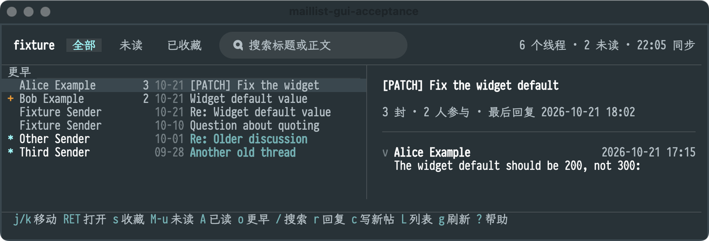

# maillist

[ETAF](https://github.com/emacs-taf/etaf) mailing-list client for Emacs. It
reads public-inbox archives — the thread list, the conversation and each
message — and keeps the reader's own read and starred marks, and the fetched
bodies, in a local SQLite file. Replies and new posts open in `message-mode`
and leave through smtpmail.

At a wide frame the list and the open thread share the window; the divider
between them is draggable:


Below `maillist-narrow-width` the two columns become one: the list first, then
the open thread with a way back above it.


A short window keeps the header, the rows and the reader without stretching
either column past the canvas:



## Capabilities

- Thread list with the archive's own date grouping, unread and starred scopes,
  and one row per discussion.
- Reads the conversation message by message: quotes, patch hunks and the
  addresses a message mentions are marked up, and a long thread opens with its
  newest messages and grows on demand.
- Search in the archive's own syntax (`from:`, `subject:`, dates) plus local
  marks; a search the archive cannot answer is served from the cached bodies.
- Read marks: opening a thread marks it read once its body is on screen,
  `M-u` puts it back in the queue and `A` clears a scope.
- Older mail than the archive's first page loads from its date search, one
  batch per keypress.
- Several archives (`emacs-devel`, `emacs-user`, `emacs-bugs`, list tangents)
  switch from inside the client, which remembers the last one.
- An open client syncs on a schedule; a thread the archive added is counted in
  the summary and tinted in the list.
- Reply to the list, reply to the author, or post anew, with `In-Reply-To` and
  `References` filled in.

## Requirements

- Emacs 29.1 or newer, built with SQLite.
- For a checkout, the provider repositories on `load-path`: `etaf`, `etaf-ui`,
  `ebox`, `ecss`, `etaf-db`.

## Install

From the ETAF package archive:

```elisp
(require 'package)
(add-to-list 'package-archives '("etaf" . "https://etaf.top/packages/"))
(package-initialize)
(package-refresh-contents)
(package-install 'etaf-install)
```

Then `M-x etaf-install`, pick Maillist, and the installer brings ETAF, ETAF UI
and ETAF DB with it. `M-x maillist-open` starts the client.

From a checkout, add this repository and the provider roots to `load-path`:

```elisp
(require 'maillist)
M-x maillist-open
```

## Keys

| Key | Action |
| --- | --- |
| `j` / `k` | next / previous thread |
| `RET` or a click | open the thread |
| `1` `2` `3` | all, unread only, starred only |
| `M-u` | mark the open thread unread |
| `A` | mark every shown row read |
| `s` | star or unstar |
| `e` | expand the older messages a long thread holds back |
| `o` | load mail older than the list |
| `/` | search |
| `M-p` / `M-n` | recall the previous / next search |
| `g` | sync again (re-runs the open search when one is active) |
| `C` | copy the archive page of the thread |
| `B` | open that page in the browser |
| `r` / `C-u r` | reply to the list / to the last message's author |
| `c` | post a new message |
| `L` | switch archive |
| `u` | back from the thread to the list (narrow layout) |
| drag the divider | resize the list (arrow keys move it once focused) |
| `n` / `p` / wheel | scroll inside the list or the reader |

## Search syntax

| Form | Effect |
| --- | --- |
| `from:` `to:` `subject:` `body:` `message:` | the matching archive field |
| `after:2026-10-01` `before:2026-10-10` | date range |
| `is:unread` `is:starred` | local marks, no request |

A query with only local conditions filters the list in place; `g` runs the
current search again. The thread being read stays in the list, so `j` carries
on from it.

## Sending

Sending goes through smtpmail. Store the account's application password in
auth-source once:

```elisp
(setq maillist-mail-address "you@gmail.com")
;; then M-x maillist-mail-configure and paste the application password
```

The defaults are `smtp.gmail.com:465` with SSL; change
`maillist-smtp-server`, `maillist-smtp-service` and
`maillist-smtp-stream-type` for another provider. The password is read when
the mail is sent, so a reply can be written before the account is configured.
GNU lists hold posts from unsubscribed addresses for moderation.

## Data and network

- Threads, marks, cached bodies and the last archive live in
  `~/.emacs.d/maillist/store.sqlite3` (`maillist-store-file`). The file uses
  WAL, so a second Emacs can read while the first writes.
- The cache is bounded: `maillist-thread-limit` threads per archive and
  `maillist-body-limit` cached bodies; a prune keeps the newest of each and
  never drops a mark.
- `maillist-network-route` picks the leading route: `auto` tries direct first,
  `proxy` tries the proxy first, `direct` never uses one. A route that cannot
  connect or stops answering hands the request to the other one
  (`maillist-route-attempt-timeout`), so a proxy client that is not running
  does not take the archive offline, and a blocked direct path still has the
  proxy. `maillist-proxy` names the proxy; empty takes it from
  `url-proxy-services` or the environment. A failed request names what it
  could not reach, for example
  `无法连接代理 127.0.0.1:7890；无法连接档案 yhetil.org:443`.
- `maillist-auto-refresh` (300 seconds by default) syncs an open client. Set
  it to nil to sync only on demand.

`docs/manual.md` covers the workflows, every configuration variable, the
storage layout and what to do when a sync, a search or a send fails.

## Development

```sh
make check     # structure, byte compilation, acceptance scenarios, public API
make test      # acceptance scenarios only
make gui       # drive the maintained GUI scenario on a running Emacs server
make clean
```

The acceptance scenarios read the fixture archive under
`tests/fixtures/archive` over `file:` URLs, so they need no network. `make gui`
takes `SERVER=<name>` for a dedicated instance and prints the evidence
directory of the run; the frames it saves are what a UI change is reviewed
against.
