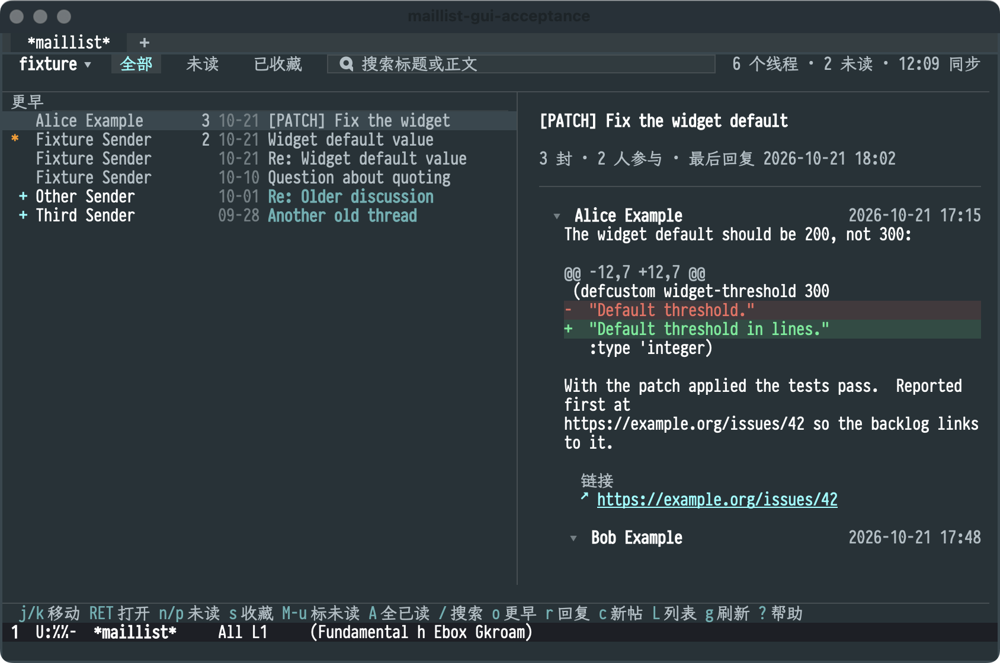
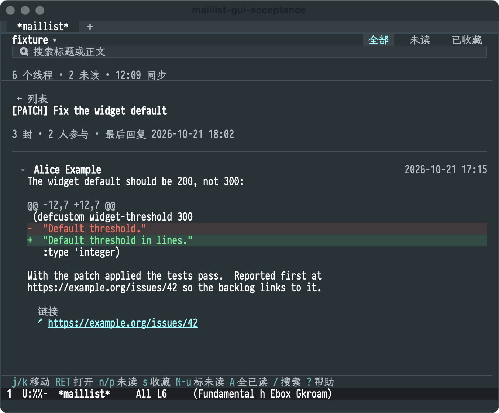

# maillist

[ETAF](https://github.com/emacs-taf/etaf) mailing-list client for Emacs. It
reads public-inbox archives — the thread list, the conversation and each
message — and keeps the reader's own read and starred marks, last-read
snapshots, settings and cached bodies in a local SQLite file. Replies and new
posts open in `message-mode` and leave through smtpmail or Emacs's own
`message-send-mail-function`.

At a wide frame the list and the open thread share the window; the divider
between them is draggable and remembers its width:



Below `maillist-narrow-width` the two columns become one: the list first, then
the open thread with a way back above it.



A short window keeps the header, the rows and the reader without stretching
either column past the canvas:


## Capabilities

- Thread list with date grouping, unread (`+`) and starred (`*`) markers,
  all/unread/starred scopes, and automatic new-reply detection when a
  previously read discussion gains new messages.
- Conversation reader with fixed header, per-message focus (`[` / `]`),
  collapse-all (`z`), long-quote folding (`Q`), nested quote bars, full unified
  diff highlighting, signature dimming, raw RFC 5322 viewer (`v`), mbox patch
  link (`m`), and extracted clickable links.
- Search in mail-client syntax (`from:`, `to:`, `subject:`, `body:`,
  `message:`, negated `-field:`, `after:`, `before:`, `is:unread`, `is:read`,
  `is:starred`, `-is:...`). Local mark queries filter live; remote queries run
  on `RET` and fall back to structured local search over cached threads and
  bodies when offline.
- Read marks with last-read snapshots: opening a thread marks it read once its
  body is on screen, `M-u` puts it back in the queue, `A` clears a scope, and
  offline cached threads stay readable when a refresh fails.
- Older mail loads via the archive's native `?t=...` index pagination when
  available, or timestamped date search with automatic offset stepping.
- Multiple archives (`emacs-devel`, `emacs-user`, `emacs-bugs`,
  `emacs-tangents`, plus custom sources added via `L` or `M-x maillist-add-source`)
  stored per list without cross-post collisions.
- Scheduled quiet sync (`maillist-auto-refresh`) with new-thread and new-reply
  counts, plus ETAF regions (`M-g f` / `M-g t` / `M-g v`) and in-buffer `?`
  help.
- Reply to any focused message (`r` list, `R` reply-all, `C-u r` author) or
  post anew (`c`), with canonical RFC 5322 `In-Reply-To` and ancestor-chain
  `References`, and automatic `<bug>@debbugs.gnu.org` routing for `emacs-bugs`.

## Requirements

- Emacs 29.1 or newer, built with SQLite.
- For a checkout, the provider repositories on `load-path`: `etaf`, `etaf-ui`,
  `ebox`, `ecss`, `etaf-db`.

## Install

From the ETAF package archive:

```elisp
(require 'package)
(add-to-list 'package-archives '("etaf" . "https://etaf.top/packages/"))
(package-initialize)
(package-refresh-contents)
(package-install 'etaf-install)
```

Then `M-x etaf-install`, pick Maillist, and the installer brings ETAF, ETAF UI
and ETAF DB with it. `M-x maillist-open` starts the client.

From a checkout, add this repository and the provider roots to `load-path`:

```elisp
(require 'maillist)
M-x maillist-open
```

## Keys

| Key | Action |
| --- | --- |
| `j` / `k` | next / previous thread |
| `RET` or click | open the thread |
| `n` / `p` | next / previous unread thread |
| `<` / `G` | jump to the first / last row |
| `]` / `[` | focus next / previous message in the open thread |
| `SPC` / `DEL` / `S-SPC` / wheel | page down / up inside the reader (or list) |
| `1` `2` `3` | all, unread only, starred only |
| `M-u` | mark the selected thread unread |
| `A` | mark every shown row read |
| `s` | star or unstar |
| `e` | expand older messages held back in a long thread |
| `z` | collapse or expand every message in the open thread |
| `Q` | fold or unfold long quoted blocks (3+ lines) |
| `v` | view raw RFC 5322 email and full headers of the focused message |
| `m` / `w` | copy thread `t.mbox.gz` URL / copy focused `<Message-ID>` |
| `o` | load mail older than the list |
| `/` | focus search field (`RET` runs remote search; empty restores list) |
| `M-p` / `M-n` | recall previous / next search |
| `g` | sync again (re-runs the active search when searching) |
| `C` / `B` | copy / open the archive page of the thread |
| `r` / `R` / `C-u r` | reply to list (or Debbugs bug) / reply-all / reply to author |
| `c` | post a new message |
| `L` | switch archive or add a new public-inbox source |
| `u` | back from the thread to the list (narrow layout) |
| `M-g` / `Tab` / `?` | jump region (`f` search, `t` list, `v` reader) / next region / help |
| drag the divider | resize the list (saved automatically; arrows move when focused) |

## Search syntax

| Form | Effect |
| --- | --- |
| `from:` `to:` `subject:` `body:` `message:` | matching archive field (prefix `-` to exclude) |
| `after:2026-10-01` `before:2026-10-10` | date range |
| `is:unread` `is:read` `is:starred` | local marks (`-is:...` negates), no request |
| `"two words"` | exact phrase |

Local-only mark queries filter the archive list in place; remote queries run on
`RET` and fall back to structured local search across cached subjects, authors
and bodies when offline. Clearing the search restores the full cached archive
list immediately.

## Sending

Sending defaults to smtpmail. Store the account's application password in
auth-source once:

```elisp
(setq maillist-mail-address "you@gmail.com")
;; then M-x maillist-mail-configure and paste the application password
```

The defaults are `smtp.gmail.com:465` with SSL; change
`maillist-smtp-server`, `maillist-smtp-service` and
`maillist-smtp-stream-type` for another provider, or set
`maillist-send-mail-function` to `'inherit` to use Emacs's own
`message-send-mail-function` (such as `msmtp`, `sendmail` or `gmi`). Replying
inside `emacs-bugs` automatically targets `<bug>@debbugs.gnu.org`.

## Data and network

- Threads, marks, cached bodies and settings live in
  `~/.emacs.d/maillist/store.sqlite3` (`maillist-store-file`) in WAL mode.
  Threads are keyed by `(list, id)` and messages by `(thread, id)`, so
  cross-posted discussions and sub-threads never clobber each other.
- Retention is bounded per archive (`maillist-thread-limit` 2000,
  `maillist-body-limit` 400); starred threads and marks are never dropped, and
  freed pages are reclaimed incrementally without blocking the UI.
- **Fast persistent NNTP sync & reading**: the four built-in `yhetil.org`
  archives sync incrementally via NNTP (`GROUP` + `XOVER` with authors and
  threading included) and fetch thread messages via pipelined `ARTICLE` bursts
  with automatic HTTP fallback; unchanged cached threads open in 0 ms and top
  unread threads warm quietly in the background (`maillist-prefetch-bodies`).
- `maillist-network-route` picks the leading route (`auto`, `proxy`, `direct`)
  with sticky working-route caching, disabled broken HTTP/1.1 keep-alive reuse,
  and fallback after `maillist-route-attempt-timeout` seconds (10).
  `maillist-proxy` names an HTTP(S) proxy (`HOST:PORT`), falling back to
  `url-proxy-services` or `HTTP(S)_PROXY` (ignoring SOCKS addresses).
- `maillist-auto-refresh` (300 seconds by default) syncs an open client
  quietly without disturbing an active search view.

`docs/manual.md` covers the workflows, every configuration variable, the
storage layout and what to do when a sync, a search or a send fails.

## Development

```sh
make check     # structure, byte compilation, acceptance scenarios, public API
make test      # acceptance scenarios only
make gui       # drive the maintained GUI scenario on a running Emacs server
make clean
```

The acceptance scenarios read the fixture archive under
`tests/fixtures/archive` over `file:` URLs and loopback HTTP sockets, so they
need no network. `make gui` takes `SERVER=<name>` for a dedicated instance and
prints the evidence directory of the run; the frames it saves are what a UI
change is reviewed against.
